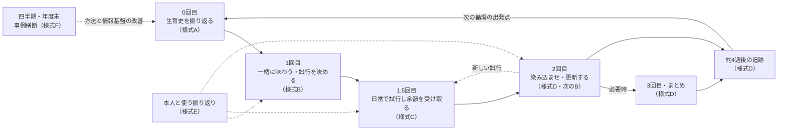
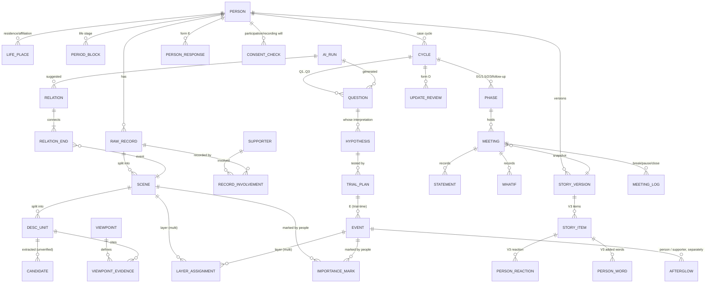

# TOMONI ケースカンファレンス支援システム 要件定義書（初版・MVP中心）

| 項目 | 内容 |
|---|---|
| 文書版 | 0.7（ドラフト） |
| 作成日 | 2026-11-06 |
| 対象 | 当事者参加型ケースカンファレンス（仮称：やまゆりルーム）の循環を支える情報基盤（TS-3 ライフストーリー構築支援システムを中核とする） |
| 開発担当 | 静岡大学情報学部（計画書 3.2.3） |
| 状態 | 要レビュー（福祉機構・東京大学チーム・ピアサポーターによる確認前） |

**改訂履歴**

| 版 | 日付 | 内容 |
|---|---|---|
| 0.1 | 2026-11-06 | 初版。業務フロー、機能要件 F-1〜F-14、ライフストーリー3ビュー（V1 全体概要版・V2 詳細版・V3 本人向け絵巻物） |
| 0.2 | 2026-11-06 | 次の点を変更した。<br>・トップ画面をダッシュボード（F-0、二層構成）とした<br>・関係の種類に「制度による対応」を追加した<br>・レイヤ規則を拡充した（病気＝身体・身体サイン、生活＝意思・好悪・支援・嗜好・選好・パーソナリティ）<br>・V1 に、人が付ける重要度による大小を導入した（P-7 を修正） |
| 0.3 | 2026-11-06 | 次の点を変更した。<br>・アクセシビリティ要件を追加した（P-10、8.3）。準拠対象は WCAG 2.2 AA（= ISO/IEC 40500:2025）と ISO 9241-171:2025、本人向け画面には W3C COGA。確認手順は skills（a11y-compliance, coga-person-view）として定めた<br>・V3 本人向け絵巻物（F-3.5）と会議画面（F-7）の要件を、試作を踏まえて詳細化した<br>・V1 の操作に、キーボード操作とドラッグ以外の期間指定を追加した。V2 の時期の区切りと「戻る」を具体化した<br>・データ要件に、本人の反応・本人が加えた言葉・会議ログを追加した。日付のない回想記録の扱い（SD-8）を追加した<br>・試作（prototype/）の実装状況（10.3）と未決事項 U-17〜U-19 を追加した |
| 0.4 | 2026-11-06 | 本人のケース会議ダッシュボード（F-0.2）を、A4 1ページで全体が分かる要約に変更した。各パネルの全内容は詳細ページ（F-0.6）に移した。A4横の印刷（FR-0.2.9）を追加した |
| 0.5 | 2026-11-06 | ダッシュボードの番号を ①ライフストーリー・②3つの問い・③振り返り・④実践結果の集約・⑤気づき・未確認・⑥次にやること に改めた。本人が自分でアプリを使うことを基本とし、「代理入力」の考え方を「手伝い」に改めた（FR-3.4.5, FR-3.7.2, F-3.5） |
| 0.6 | 2026-11-06 | V3 を、本人が自分で操作しやすいように改めた。1画面の情報を減らした。「いまは みない」はその場面だけを飛ばすようにした。言葉はカードと声でも入れられる。二度押しで取り消されないようにした。声は「いつも きく」を選べる。← → キーで移動できる（FR-3.5.3, FR-3.5.11〜3.5.14）。本人の立場を選ぶと V3 が開き、立場を端末に保存する（FR-0.1.5） |
| 0.7 | 2026-11-07 | 次の点を改めた。<br>・V2：引用文の発言者を分けた（本人／母／父／支援者／その他の家族／不明）。発言者が分からない引用は「引用文：発言者未確認」と表示する<br>・V2：本文・補足を16px以上にした。現在地図を縮小・折りたたみできるようにし、拡大時・狭幅時は追従しない<br>・V1：見出しと図を先に置き、短い凡例を示す。「詳しい読み方」は展開式にした。関係線は初期表示を絞った。選んだ出来事を図の直下に示し、要約へのボタンを付けた。年・時期から一覧に入れるようにした（FR-3.1.6, 3.1.7, 3.1.14〜3.1.16, FR-3.2.10〜3.2.12, SD-9） |

---

## 1. はじめに

### 1.1 目的

本システムは、当事者参加型ケースカンファレンスの「0回目 → 1回目 → 1.5回目 → 2回目（→ 3回目・まとめ）→ 追跡 → 次の循環」を、記録を途切れさせずに回し続けるための情報基盤である。

目指すのは、支援者が本人への理解を深めてケアの質を高め、その結果として本人の QOL・Well-being が向上することである（pptx p2）。システムは判断を代行しない。本人と支援者が同じ材料を横に並んで眺め、考え続けるための「第三項」として機能する（計画書 3.2.2）。

### 1.2 対象範囲

| 区分 | 内容 |
|---|---|
| **MVP（2026年度）** | 中井やまゆり園の7名 × 2〜3回（計14〜21回）のカンファレンスを、0回目〜追跡まで循環運用できること。主な機能は、ケース会議を軸にしたダッシュボード（トップ画面）、pptx の5機能、ライフストーリーの3ビュー（概要版・詳細版・本人向け絵巻物）、3種の問い生成、様式A〜Fに相当する記録、本人向け振り返り画面、家族・ピアの持ち寄り入力 |
| **将来拡張（2027年度〜）** | SS-1〜SS-5 のセンシング連携、SS-7/SS-9 のケアスキル学習支援、TS-2 意思・選好伝達インタフェース、BV-1〜BV-3、SS-10 VR 連携、多施設展開（10章） |
| **対象外** | 人事評価、虐待の個人摘発を目的とする機能、本人の意思・気持ち・原因を確定する機能 |

### 1.3 用語

| 用語 | 定義 |
|---|---|
| 本人 | カンファレンスの中心となる利用者（当事者）。システム上は研究用ID（例 `P001`）で扱う |
| 支援者 | 日常の支援者（支援員・看護師・工房職員など）。シーズデータでは `支援者マスタ`（S001〜） |
| 家族・ピア | 家族・保護者、ピアサポーター（経験専門家） |
| 進行役 | カンファレンスのファシリテーター。オーケストレーション機能を担う（計画書 3.2.1(1)） |
| 研究員 | 資料の整理と評価を担当する研究員（参考資料3） |
| 原記録 | 既存の支援記録・相談記録などの原文（`原記録` シート） |
| 場面 | 原記録を出来事単位に区切ったもの（`場面` シート、`C0101` 形式）。ライフストーリー上の「イベント」の基本単位 |
| 記述ユニット | 場面をさらに文単位に分けたもの（`記述ユニット` シート、`U0101_01` 形式） |
| 候補 | 記述ユニットから自動抽出された意思表出・好き苦手・支援試行・身体サイン・解釈・仮説。**未検証の候補であり、事実ではない** |
| レイヤ | ライフストーリーの3つの層。**病気**（身体・健康・医療）、**生活**（暮らし・関係・活動・好き苦手・本人の表現）、**社会制度**（判定・手帳・措置・入退所・転居・制度利用・権利制限）。1つのイベントが複数のレイヤに属してよい |
| 関係 | イベント間の結び付き。人が確定したものと AI・規則による候補がある。**因果を意味しない** |
| 制度による対応 | 関係の種類の一つ。制度・規則・判定・人員配置基準・感染対策などが、取り得た支援や対応を**制約した**（この制度のためにこういう対応しかできなかった）、または**可能にした**（この制度があったからこういう対応ができた）という見方 |
| 重要度（大切さの印） | 本人・支援者・家族・ピアが、イベントに「大切だと思う」と付ける印。誰が付けたかを保持する。**システムは算出しない** |
| ダッシュボード | トップ画面。ホーム（担当事例の一覧）と、本人のケース会議ダッシュボード（問い・振り返り・実践結果・ライフストーリーを集約）の二層からなる |
| 問い（Q） | カンファレンスで本人と確かめたいこと。3種（常に考える／気づき／What-if）がある |
| 仮説 | 本人の願いや経験についての暫定的な見方。「誰の解釈か」と根拠を必ず付ける |
| 試行計画（P） | 1回目に決める小さな試行。誰が・どこで・何を・止める条件・余韻の確認時期を含む |
| 出来事（E） | 1.5回目の試行や日常で起きた、記録単位の出来事 |
| 余韻 | 試行の後に本人と支援者の双方に残る感覚。本人のその後の表現と、支援者自身の余韻を**分けて**記録する |
| 第三項 | 本人と支援者が一緒に眺める外在化された材料（ライフストーリーのビュー、写真、図、問いのカード等） |
| 絵巻物 | 本人と一緒に見て追加・修正する、写真・絵・短い言葉によるライフストーリー（本人向けビュー V3） |
| 確認状況 | 本人と確認できた／本人未確認／今回は尋ねていない／本人が回答を見送った／記録を希望しない、の5値 |

### 1.4 参照文書

| 略称 | 文書 |
|---|---|
| 計画書 | `doc/参加型アクションリサーチによる…5カ年研究計画書（Ver.3）.docx`。特に 3.2.1（進め方 (1)〜(7)）、3.2.2、7.3〜7.5、8章、参考資料3（様式A〜F）、参考資料4（SS/TS/BV） |
| pptx | `doc/ライフヒストリー支援.pptx`（p1〜p10） |
| シード | `data/TOMONI_study_CaseConferenceSupportSystemDB20261101.xlsx` |
| 概要版の参考図 | Accurat「My reign for a (solved) paradox」（横軸の時間上にイベントをノードとして置き、曲線で関係を示し、凡例「How to read it?」を付けた構成）<br>https://miro.medium.com/v2/resize:fit:2000/format:webp/1*3-wYldgUb07dtBxqU1REvg.jpeg |
| WCAG 2.2 | W3C Web Content Accessibility Guidelines 2.2（https://www.w3.org/TR/WCAG22/）。適合目標はレベル AA |
| ISO/IEC 40500:2025 | WCAG 2.2 を ISO/IEC 規格として発行したもの（https://www.iso.org/standard/91029.html）。内容は WCAG 2.2 と同一 |
| ISO 9241-171:2025 | 人間工学 ― ソフトウェアアクセシビリティの指針（https://www.iso.org/standard/86308.html） |
| COGA | W3C「Making Content Usable for People with Cognitive and Learning Disabilities」（https://www.w3.org/TR/coga-usable/）。本人向け画面の設計の基準 |
| skills | `.claude/skills/a11y-compliance/`（WCAG 2.2 AA・ISO 9241-171 の確認手順、axe による自動確認スクリプト）、`.claude/skills/coga-person-view/`（本人向け画面の設計規則） |
| 確認レポート | `docs/a11y-report.md`（アクセシビリティ確認の結果と未確認事項） |
| 試作 | `prototype/`（シーズデータによる動作試作）、`scripts/build_seed.py`（シード変換とレイヤ・関係候補の生成） |
| 詳細版の参考図 | Visme「Interactive Biographical Timeline」（縦スクロールで時期ブロックをたどり、左右交互のカードに写真を添えた構成）<br>https://assets.visme.co/templates/blockinfographics/fullsize/i_Interactive-Biographical-Timeline_full.jpg |

---

## 2. 設計原則

すべての機能要件はこの原則に従う。原則に反する要件は採用しない。

| ID | 原則 | 出典 |
|---|---|---|
| P-1 | **AIは本人の気持ちを決めない。** AIの出力は常に「推定」と明示し、本人の表現を常に優先する。本人・代諾者・ピアサポーターは AI 推定を否定・修正できる（オーバーライド権） | pptx p2、計画書 7.5 |
| P-2 | **4つの区別を保持する。** 本人の表現（原文）、観察事実、誰がどう解釈したか、AI推定をデータ上でも画面上でも区別する。AI 出力を本人の発言欄へ転記できないようにする | 計画書 3.2.1(6)、様式C |
| P-3 | **解釈を一つに収束させない。** 複数の解釈と根拠を併存させて保持する。多数決や AI の確信度で本人の意思を決めない。問いは正解へ誘導しない。**関係線は因果を意味しない**ことを表示上も保証する | pptx p4、参考資料3 |
| P-4 | **確認状況を明示する。** 確認状況（1.3）を記録の単位ごとに持たせる。沈黙や無反応を、同意・拒否・能力不足として自動分類しない。空欄や未確認を0点・否定として扱わない | 参考資料3 |
| P-5 | **止められる。** 拒否・苦痛が認められた場合に、試行と研究記録を即時に停止できるようにする。停止しても必要な支援は継続する | 計画書 3.2.1(4)(7) |
| P-6 | **根拠を追跡できる。** 問い・仮説・要約・関係・AI 推定はすべて根拠 ID（原記録ID／場面ID／記述ID／出来事ID）に遡れるようにする | 計画書 7.5④ |
| P-7 | **序列化しない。重要度は人が付ける。**<br>・本人も支援者も順位付け・合否判定をしない。<br>・支援者のデータは省察のためだけに使い、人事評価に流用しない。<br>・イベントの重要度はシステムが自動で算出・決定しない。人が付けた印だけを使い、誰が付けたかを示す。<br>・本人が付けた印を最も優先して表示する。 | 計画書 7.6、参考資料3 |
| P-8 | **データ区分を混同させない。** 原記録由来／派生（自動抽出候補）／模擬入力／本システムで新たに作成したデータを区別し、画面に常に表示する | シード `利用ガイド` |
| P-9 | **紙でも回せる。** 紙・写真・日誌だけでも実施できる運用を前提とし、システムは追加負担を増やさない。紙の様式A〜Fと1対1で対応づけられるようにする | 参考資料3「情報技術との関係」 |
| P-10 | **だれもが使える。** すべての画面を WCAG 2.2 AA（= ISO/IEC 40500:2025）と ISO 9241-171:2025 に準拠させる。本人と使う画面は、さらに COGA の設計パターンに従い、本人・ピアとの共同評価で確かめる。「準拠」と表示・記載できるのは、確認レポートで全項目が合格または対象外になったときに限る | 依頼者指定の規格、計画書 7.4⑦ |

---

## 3. 業務フロー（To-Be）

### 3.1 循環の全体像



全体を通じて、各会議の冒頭とすべての過程で参加・記録の意思を確認する（計画書 3.2.1(7)、7.3）。

### 3.2 フェーズ別の業務とシステム支援

| フェーズ | 目安時期 | 参加者 | 業務（計画書 3.2.1） | 入力 | 出力 | 主な機能 | 様式 |
|---|---|---|---|---|---|---|---|
| 0回目 | 1回目の1〜2週前 | 本人・希望する関係者・支援者・ピア・研究員 | 生育史、生活環境の変化、大切な人・場所・活動、これまでの選択を振り返る。直近1〜2週など本人に合う期間の記録を出発点にする | 原記録、写真・作品、家族・支援者の語り | ライフストーリー初版（レイヤ・関係の確定）、個別の問い（1〜3個）、出発点の場面、参加を支える工夫 | F-0, F-2, F-3, F-4, F-5, F-11 | A |
| 1回目 | — | 本人・支援者・家族・ピア・研究者・進行役 | 今のエピソード（困難・安心・楽しみ）と生育史を重ねて「一緒に味わう」。見方の共通点・相違点を可視化し、小さな試行を決める | ライフストーリー（概要版で俯瞰し、詳細版で掘り下げる）、問い、場面 | 解釈の一覧（誰の・根拠・別の可能性）、試行計画（担当・場面・観察・止める条件・余韻の確認日） | F-0, F-3, F-4, F-6, F-7, F-10, F-11 | B（E） |
| 1.5回目 | 1回目と2回目の間 | 日常の支援者・本人 | 試行案を実践する。試行時は短く記録し、後刻〜数日後に本人のその後の表現と支援者自身の余韻を追記する（1記録3〜5分＋追記） | 試行計画 | 出来事、試行時記録、余韻（本人／支援者を分ける）、中止記録 | F-0, F-8, F-10, F-14 | C-1, C-2（E） |
| 2回目 | 初回から2〜4週後 | 本人・支援者・ピア・研究者等 | 出発点・試行時・その後を比較する。仮説の維持・修正・保留を整理し、支援・環境・ライフストーリーを更新して次の試行を決める | 出来事・余韻・問い | 4観点の変化、仮説の更新、ライフストーリーの新版、次の試行計画 | F-0, F-9, F-7, F-3, F-14 | D、次のB |
| 3回目・まとめ | 2回目で相談 | 本人と参加者 | 残る問いと継続する支援をまとめ、生活への引継ぎ担当と次の確認日を決める。全2回の場合は2回目に含める | 2回目までの記録 | まとめ（本人にわかる形）、引継ぎ | F-0, F-9, F-10 | D |
| 追跡 | まとめの約4週後 | 支援者・研究員・本人 | 続いている変化、戻ったこと、新たな困りごとを既存記録と本人への確認で追う。会議は必須としない | 既存記録 | 追跡記録、次の循環の出発点 | F-0, F-9, F-14 | D |
| 事例横断 | 四半期・年度末 | 研究班（ピア含む）、当事者評議会へ必要範囲を共有 | 事例ごとの問い・参加条件・試行・支援変更・生活の変化・負担を同じ項目で並べ、方法と情報基盤を改善する | 全事例の記録 | 横断表（分母・未確認数つき） | F-0, F-13, F-12 | F |

**ダッシュボードの位置付け:** すべてのフェーズは、本人のケース会議ダッシュボード（F-0.2）から始まり、そこへ戻る。各フェーズの記録（問い・試行・余韻・更新）はダッシュボードに集約され、次のフェーズの入口になる。

**間隔の変更:** 上の間隔は本人の生活リズムと負担に応じて変更できる。変更した場合は、変更日・理由・引き継ぐ内容を記録する（FR-1.4）。

---

## 4. 利用者とロール

| ロール | 主な利用場面 | 端末 | 閲覧範囲（計画書 7.4⑦） | 主な操作 |
|---|---|---|---|---|
| 支援者（日常の担当職員） | 1.5回目の記録、会議への参加 | タブレット中心 | 担当する本人のみ | 試行・余韻の記録、解釈の追加、問いへのコメント |
| 進行役 | 会議の進行 | PC・大画面 | 担当事例 | 会議画面とライフストーリービューの操作、論点の整理、試行計画の確定 |
| 研究員 | 0回目の資料整理、評価、事例横断 | PC | 研究用データ（仮名化済み）。原記録は承認範囲のみ | 取込み、候補・レイヤ・関係の人手判定、問い生成の実行、横断分析 |
| 本人 | 0〜2回目、日常、追跡（**自分で操作することを基本とする**） | タブレット | 本人向け絵巻物（V3）と本人に関する本人向け表示のみ | 絵巻物を見る・選ぶ・訂正する、様式E相当の回答、「いまは こたえない」 |
| 家族・保護者 | 0回目の持ち寄り、会議 | タブレット・PC | 本人が同意した範囲 | 写真・語りの追加、解釈・別の見方の追加、関係の提案 |
| ピアサポーター | 会議、解釈の検討 | タブレット・PC | 担当事例の本人が同意した範囲 | 解釈・関係の追加、AI 推定の否定・修正（human-in-the-loop 必須） |
| 施設管理者 | 運用管理 | PC | 自施設（集計のみ。個別の省察データは対象外） | 利用者・担当割当の管理 |
| システム管理者（保守） | 保守 | PC | 研究データの内容は閲覧しない（権限を分離） | 設定、バックアップ、ログ管理 |

**ロールの原則**
- 支援者個人の省察データ（F-12 の個人別表示）は、その支援者本人だけが閲覧できる。
- 本人向けの画面は、わかりやすい版資料と同様に当事者と共同で設計する（計画書 7.4⑦）。

---

## 5. 機能要件

**記法**
- 優先度: **M** = MVP必須、**S** = MVPで望ましい、**F** = 将来。
- 各機能の「受入基準」は、MVP 受入試験の判定条件とする。

### F-0 ダッシュボード（トップ画面）

本アプリはケース会議を軸に使う。ログイン後のトップ画面はダッシュボードとし、次の二層で構成する。
- **ホーム:** 担当する事例の一覧。
- **本人のケース会議ダッシュボード:** 主な作業画面。本人ごとの問い・振り返り・実践結果・ライフストーリーを1画面に集約する。

すべての要素から、元の記録や原典（原記録）までたどれるインタラクティブな画面とする。

#### F-0.1 ホーム（担当事例の一覧）

```
┌───────────────────────────────────────────────────────────────────────┐
│ TOMONI  ホーム        [会議カレンダー]  [事例横断（様式F）]   ログイン: 西田（支援員）│
├───────────────────────────────────────────────────────────────────────┤
│ 今週の会議: 11/12 P001 2回目 / 11/14 P004 1回目                          │
├──────────────────────┬──────────────────────┬──────────────────────┤
│ P001  ●●●◐○○        │ P002  ●◐○○○○        │ P003  ●●●●●◐        │
│ 1.5回目（試行中）      │ 0回目（準備中）        │ 追跡                  │
│ 次: 2回目 11/12        │ 次: 1回目 11/20        │ 次: 追跡確認 12/01     │
│ 余韻の追記待ち 2件     │ 未判定の候補 41件       │                      │
│ 意思確認の期限 12/03   │                      │                      │
└──────────────────────┴──────────────────────┴──────────────────────┘
```

| ID | 要件 | 優先度 |
|---|---|---|
| FR-0.1.1 | 閲覧権限のある本人ごとにカードを表示する。カードの項目: 研究用ID、循環の進行状況（ステッパー）、現在のフェーズ、次の会議・確認日、余韻の追記待ち件数、試行中止の有無、意思確認の期限、未判定の候補件数 | M |
| FR-0.1.2 | 進行役・研究員向けに、会議予定のカレンダーを表示する（全担当事例） | M |
| FR-0.1.3 | カードの並び順は、次の予定日順または研究用ID順とする。本人の「状態の良し悪し」による並べ替えや色分けはしない（P-7） | M |
| FR-0.1.4 | カードを選ぶと、本人のケース会議ダッシュボード（F-0.2）を開く | M |
| FR-0.1.5 | 本人ロールでログインした場合は、ホームを表示せず、本人向け画面（V3・様式E）を開く。試作では、立場の選択を端末に保存し、「本人」を選ぶと V3 を開く | M |

#### F-0.2 本人のケース会議ダッシュボード

```
┌──────────────────────────────────────────────────────────────────────────────┐
│ P001 ／ 循環1 ／ 0回目●─1回目●─1.5回目◐─2回目○─まとめ○─追跡○   [会議を始める]  │
│ 焦点: C1008 午前と夕方で異なる反応   版: v3（11/05）   [模擬データを含む]         │
├───────────────────────────────┬──────────────────────────────────────────────┤
│ ② 3つの問い                   │ ① ライフストーリー（V1 ミニ表示）                  │
│ ①常に考える  [採用] 根拠:C1008 │ 病気  ・  ●   ・    ●  ・ ●                        │
│ ②気づき      [未レビュー]      │ 生活  ● ● ⬤ ●   ●  ● ⬤★試行                        │
│ ③What-if     [編集済]          │ 制度  ●  ◆   ●    ◆   ●                          │
│   └ 根拠チップ U1008_01 …     │ 〔クリックで V1／V2 を開く〕                       │
├───────────────────────────────┼──────────────────────────────────────────────┤
│ ③ 振り返り                     │ ④ 実践結果の集約                                  │
│ 仮説H1: 維持／H2: 修正／H3: 保留 │ P1 午前の写真帳の時間を夕方にも ▶ 実施3 未実施1 中止0 │
│ 余韻（本人）: 写真帳を自分から… │   本人の反応 ──●──●──○──（タイムライン）           │
│ 余韻（支援者）: 驚き・安心…     │ 4観点 出発点→現在: 安心 / 表現 / 選択 / 拡大        │
│ 本人の振り返り（様式E）: また… │   ※スコアなし。根拠の出来事IDと未確認件数を表示     │
│ 共通点・相違・分からなさ        │                                                  │
├───────────────────────────────┴──────────────────────────────────────────────┤
│ ⑤ 気づき・未確認: 観点D04が少ない / 要確認の候補 38件   ⑥ 次にやること: 余韻追記(片岡) 11/08 │
└──────────────────────────────────────────────────────────────────────────────┘
```

| ID | パネル | 要件 | 優先度 |
|---|---|---|---|
| FR-0.2.1 | 見出し行（循環の進行状況） | 0／1／1.5／2／3・まとめ／追跡をステッパーで表示し、各フェーズの予定日・実施日・間隔変更の理由を示す。前の循環への切替もここで行う | M |
| FR-0.2.2 | ② 3つの問い | 生成・登録された問いを、種類（①常に考える／②気づき／③What-if）別のカードで表示する。カードには、レビュー状態（未レビュー／採用／編集済／却下）、提案者（AI／人）、根拠IDのチップ、会議で出た発言の件数を示す。ここから問いの再生成・編集・採否ができる（F-4） | M |
| FR-0.2.3 | ③ 振り返り | 次を表示する: 仮説ごとの状態（維持・修正・保留）と理由、余韻（本人のその後の表現と支援者自身の余韻を**分けて**表示）、本人の振り返り回答（様式E）と V3 での本人の反応（手伝った人・方法つき）、会議で残った共通点・相違・分からなさ、本人の訂正・拒否・保留 | M |
| FR-0.2.4 | ④ 実践結果の集約 | 次を表示する: 会議（F-7）で登録した試行計画、試行計画ごとの実施・未実施・中止の件数と、本人の反応のタイムライン（計画と実践の対比、FR-8.7）、4観点（安心・表現・選択・拡大）の出発点→現在の記述と根拠の出来事ID。数値は任意で、表示する場合は分母と未確認件数を必ず併記する。良否のスコアや合否は表示しない | M |
| FR-0.2.5 | ① ライフストーリー | V1 のミニ表示に、今回の循環の実践の出来事（試行・余韻・中止）を重ねて表示する（FR-3.1.12）。クリックで V1 または V2 の該当位置を開く | M |
| FR-0.2.6 | ⑤ 気づき・未確認 | F-5 の出力（未確認事項の件数、観点 D01〜D08 の偏り、レイヤの偏り）を表示する | M |
| FR-0.2.7 | ⑥ 次にやること | 担当者・確認日・次回への持ち越し（`会議_整理と実践` の項目）と、余韻追記・意思確認のリマインドを表示する | M |
| FR-0.2.8 | 全体 | パネルの配置は、利用場面（会議前の準備／会議中／日常）に応じて切り替えられる。タブレット幅では縦に積む | S |
| FR-0.2.9 | 全体 | **A4 1ページの要約:** ダッシュボードは全体の概要が A4 1ページ（横）に収まる要約とし、印刷しても1ページになる。配置は次の順とする。<br>・見出し行（循環の進行状況・焦点の場面）<br>・① ライフストーリーの縮小図（幅いっぱい）<br>・② 3つの問い（3列。問いは3行まで表示し、根拠と発言の件数、「強調」「開く」を付ける）<br>・③④⑤⑥ の4つのタイル（それぞれ主な件数・状態を2〜4行で示す）<br>印刷では操作ボタンを隠し、ライトの配色で出力する | M |
| FR-0.2.10 | 全体 | 各パネルの見出しに「詳しく →」を置き、詳細ページ（F-0.6）へ移動できるようにする。④には「＋記録」（出来事の記録欄を開いた状態の詳細ページ）を置く | M |

#### F-0.3 ドリルダウン（記録・原典へたどる）

| ID | 要件 | 優先度 |
|---|---|---|
| FR-0.3.1 | ダッシュボード上のあらゆる要素（問い、仮説、余韻、試行、4観点の記述、気づき）から、元の記録へ移動できる。たどる経路は、記録（会議発言・試行・余韻）→ 場面 → 記述ユニット → 原記録（原典）。原記録の表示は閲覧権限に従う（U-3） | M |
| FR-0.3.2 | 移動の経路をパンくずリストで示し、ダッシュボードの元の位置へ戻れる | M |
| FR-0.3.3 | パネル間で状態を連動させる。問いを選ぶと、ライフストーリーの根拠イベント・実践結果・振り返りの関連項目が強調される。期間やレイヤを選んだ場合も同様にする（FR-3.3.5 と同じ状態を共有する） | M |
| FR-0.3.4 | 根拠IDのチップにマウスを重ねると、原文の抜粋をポップアップで表示する | M |
| FR-0.3.5 | ダッシュボードの状態（選択中の問い・期間・レイヤ）を URL で共有でき、会議画面に「発表モード」で投影できる | M |

#### F-0.4 会議との往復

| ID | 要件 | 優先度 |
|---|---|---|
| FR-0.4.1 | 「会議を始める」から会議画面（F-7）に入る。会議画面には、ダッシュボードで選んでいた問い・焦点の場面・ライフストーリーの版を引き継ぐ | M |
| FR-0.4.2 | 会議で記録した整理欄・試行計画・What-if・関係・重要度の印は、会議の終了時にダッシュボードへ反映する。どの会議で加わったかを表示する | M |
| FR-0.4.3 | 1.5回目の試行・余韻の記録（F-8）は、保存と同時に④実践結果と①ライフストーリーへ反映する | M |

#### F-0.6 詳細ページ

| ID | 要件 | 優先度 |
|---|---|---|
| FR-0.6.1 | ダッシュボードの各パネルの全内容を、次の5つの詳細ページで表示する。<br>・② 3つの問い（採否・強調・根拠）<br>・③ 振り返り（確認できる事実・仮説・余韻・本人の反応・会議での発言）<br>・④ 実践結果の集約（試行計画・計画と実践・出来事の記録・4観点・What-if）<br>・⑤ 気づき・未確認（観点 D01〜D08 の分布と省察質問）<br>・⑥ 次にやること<br>URL は `#/p/{ID}/d/{種類}` とする | M |
| FR-0.6.2 | 詳細ページの間はタブで移動できる。「ダッシュボードへ戻る」を置く。`?at=` で、特定の問い・項目の位置（例: 出来事の記録欄）を開いた状態で表示できる | M |

#### F-0.5 区分表示

| ID | 要件 | 優先度 |
|---|---|---|
| FR-0.5.1 | ダッシュボード上の各要素に、データ区分（原記録由来／候補／AI推定／模擬入力／本システム入力）と確認状況のバッジを常に表示する（P-8） | M |
| FR-0.5.2 | 模擬データを含む場合は、ヘッダに常に「模擬データを含む」と表示する | M |

**F-0 受入基準**
- ダッシュボードを1280×900の画面で表示したとき、全体がスクロールなしで見える。A4横で印刷すると1ページになる。
- 各パネルの「詳しく →」から、対応する詳細ページへ移動できる。
- シード P001 でホームのカードから本人のダッシュボードを開ける。
- 問い（C1008）→ 根拠場面 C1008 → 原記録 10-08 まで、3クリック以内でたどれる。パンくずリストで元の位置に戻れる。
- 1.5回目の出来事を記録すると、④と①に即時に反映される。
- どの画面でも、模擬・候補・AI推定のバッジが表示される。

### F-1 本人・事例・循環の管理

| ID | 要件 | 優先度 |
|---|---|---|
| FR-1.1 | 本人を研究用IDで登録する。直接識別子（氏名等）は本システムに保持しない。対応表は機構が別管理する（8章） | M |
| FR-1.2 | 本人ごとに「事例（循環）」を作成し、フェーズ（0／1／1.5／2／3・まとめ／追跡）の予定日・実施日・状態を管理する。1人の本人に複数の循環を連ねられる | M |
| FR-1.3 | 各会議・各記録の前に、参加と記録の意思確認を記録する。記録する項目は、確認日時・方法・結果（確認状況5値）・確認者である。年1回の継続意思の再確認期限を表示する | M |
| FR-1.4 | フェーズ間隔の変更日・理由・引き継ぐ内容を記録する | M |
| FR-1.5 | 事例ごとに個別の問い（1〜3個を目安）を登録し、問いの追加・変更・終了の履歴を残す | M |

**受入基準:** シードの P001 で1つの循環を作成し、0回目〜追跡の全フェーズを状態遷移させられる。間隔を変更すると理由の入力が必須になる。

### F-2 記録の取込み・構造化

| ID | 要件 | 優先度 |
|---|---|---|
| FR-2.1 | シード xlsx の全シートを取り込み、9章のマッピングに従ってエンティティ化する。IDは変更せずに保持する | M |
| FR-2.2 | 新しい原記録（テキスト）を登録し、場面・記述ユニットに分割する（自動分割の候補を提示し、人が確定する） | S |
| FR-2.3 | 記述ユニットから候補（意思表出・好き苦手・支援試行・身体サイン・解釈仮説）を自動抽出する。抽出結果は検証状態「未検証」で登録する | S |
| FR-2.4 | 候補ごとの人手判定（確定／修正／棄却／保留）の画面を設ける。判定者・日時・理由を残す。シードの「因果関係：未判定」「意味・意思の確定：未確定」等の注記を保持する | M |
| FR-2.5 | すべてのエンティティにデータ区分（原記録由来／自動抽出候補／人手確定／模擬入力／本システム入力）と検証状態を持たせ、画面に常に表示する | M |
| FR-2.6 | 写真・絵・作品画像を添付できる。添付ごとに閲覧範囲と本人の掲載意思を設定する | M |
| FR-2.7 | **レイヤの振り分け:** 場面ごとにレイヤ（病気／生活／社会制度）の候補を自動で付与する（規則は 9.4）。人が確定・修正する。複数のレイヤへの所属を許し、主レイヤを1つ指定する。振り分けの根拠（どの語句・記録種別・所属か）を保持する | M |
| FR-2.8 | **関係の候補生成:** イベント間の関係候補を規則と AI で生成する（6.4, 7.4）。人が採用・修正・棄却する（F-3.4） | M |

**受入基準:** シードの件数（9.1）が取込み後に一致する。模擬会議のデータには、どの画面でも「模擬」表示が出る。P001 の70場面すべてにレイヤ候補が付き、人手確定の画面で修正できる。

### F-3 ライフストーリー（暮らしの歩み）ビュー（pptx 機能1／様式A／TS-3）

ライフストーリーは、同じデータ（ライフストーリー版 STORY_VERSION）を次の3つのビューで表示する。

| ビュー | 主な利用者・場面 | 参考図 | 役割 |
|---|---|---|---|
| **V1 全体概要版** | 支援者・進行役・研究員・ピア／0回目・1回目・2回目の会議（大画面） | Accurat「My reign for a (solved) paradox」 | 人生全体を俯瞰する。病気・生活・社会制度の3レイヤ上のイベントと、それらの関係を一目で見る |
| **V2 詳細版** | 同上／個別の検討、日常の振り返り（PC・タブレット） | Visme「Interactive Biographical Timeline」 | 縦スクロールで時期を順にたどり、イベントの詳細（本人の表現・原文・候補・出典・関係）を掘り下げる |
| **V3 本人向け絵巻物** | 本人と、本人が望む関係者（タブレット・大画面・印刷） | —（本人・ピアと共同設計） | 写真・絵・短い言葉で本人と一緒に眺め、追加・訂正する |

V1 と V2 は相互に行き来しやすく設計する（F-3.3）。V3 は独立したビューとするが、同じデータを共有する。

#### F-3.1 V1 全体概要版

**画面構成**

```
┌────────────────────────────────────────────────────────────────────────────┐
│ タイトル（研究用ID・版）  [レイヤ切替] [フィルタ] [問いで強調] [凡例 How to read]│
├──────────┬─────────────────────────────────────────────────────────────────┤
│ 凡例     │ 生活の場ストリップ: 家庭│通園│小学校│ひだまり学園│あさひ生活園│こもれび園│
│ （読み方）│ 記録密度ストリップ: ▂▅▃ ▁▇▂ …（年ごとの記録件数・記録者種別）       │
│          │ 時間軸: 1982 ─ 1986 ─ 1992 ─ 2000 ─ 2009 ─ 2019 ─ 2026（年齢併記）│
│ 本人の   ├─────────────────────────────────────────────────────────────────┤
│ 表現あり │ 病気    ●診断  ●服薬開始        ●看護  ●歯科治療 ●眼科  ●排便・足首│
│ 確認状況 │           ╲                       ╲___________╱                   │
│ 関係の   │ 生活   ●●  ●面会 ●活動 ●入所日   ●転居日 ●食事 ●写真帳  ●午前/夕方│
│ 線種     │          ╲___╱       ╲                    ╱                       │
│          │ 社会制度 ●手帳A2 ●再判定 ●入所 ◆拘束 ●A1 ●転居相談 ◆拘束 ●感染対策 │
├──────────┴─────────────────────────────────────────────────────────────────┤
│ 選択イベントの要約パネル（本人の表現・レイヤ・関係・確認状況）  [詳細版で開く →]│
└────────────────────────────────────────────────────────────────────────────┘
```

| ID | 要件 | 優先度 |
|---|---|---|
| FR-3.1.1 | 横軸は時間（年）とし、年齢を併記する。出生から現在までを1画面で俯瞰できる。時期の確度が低いイベント（`時期の確度`＝記録日を暫定使用 等）は、幅を持つ表示やぼかしで区別する。日付のない回想記録は、回想された期間を薄い帯で示し、確度を文字でも表示する（SD-8） | M |
| FR-3.1.2 | 縦方向に3つのレイヤの帯（**病気／生活／社会制度**）を設け、イベントをノードとして置く。複数のレイヤに属するイベントは、主レイヤにノードを置き、他のレイヤには小さなマーカーを置いて縦の細線で結ぶ | M |
| FR-3.1.3 | **関係の表示:** 関係を曲線で描く。人が確定した関係は実線、AI・規則による候補は点線とする。関係の種類（6.4）で色や線種を変える。矢印は付けず、因果を示唆しない。曲線に触れると「誰の見方か・根拠・確認状況」を表示する | M |
| FR-3.1.4 | **ノードの視覚符号化**（凡例で説明する）。色＝レイヤ。形＝記録の種類（支援記録／看護・医療記録／判定・相談記録／家族メモ／会議録／本システムの出来事）。中央の印＝本人の表現（意思表出の原文）あり。外周リング＝確認状況。◆＝権利制限的対応（身体拘束等、観点D08）を含む。**大きさ＝人が付けた重要度**（FR-3.7）とし、次の4段階で表示する。<br>(1) 本人が「たいせつ」と付けたもの（最大。本人の印であることを示す枠を付ける）<br>(2) 複数人が付けたもの<br>(3) 1人が付けたもの<br>(4) 未評価（標準サイズ）<br>ツールチップには、付けた人の内訳（立場別）と理由を表示する。重要度はシステムが算出したものではないことを凡例に明示する（P-7） | M |
| FR-3.1.4a | **見方の切替:** 大きさを「全員の印」「本人の印だけ」「特定の参加者の印だけ」で切り替えて表示できる。参加者による見方の違いを比べるために使う | M |
| FR-3.1.5 | 時間軸の上に補助ストリップを置く。**生活の場**（所属・居所の変遷を帯で示す）、**記録密度**（年ごとの記録件数を記録者種別で色分けしたヒストグラム）。記録が少ない時期は「記録が少ない」と表示し、出来事が無かったように見せない | M |
| FR-3.1.6 | **見出しと図を先に置く:** 画面の最初に、見出し・1文の説明・図を置く。図の上には短い凡例（1行。レイヤの色、記録の種類の形、大きさの意味、◆、「点線＝関係の候補（因果ではない）」）だけを常に表示する。色・形・線種・リングの詳しい意味は「詳しい読み方」として展開式にし、図の下に置く（参考図の "How to read it?" に相当） | M |
| FR-3.1.7 | 操作: レイヤの表示・非表示、期間のズーム（ホイール／ピンチ）、期間のブラシ選択、ホバーでツールチップ、クリックで要約パネル。ドラッグによる期間選択には、開始年・終了年の入力による代わりの方法を必ず用意する（WCAG 2.5.7）。**関係線の初期表示は絞る**（移行・制度による対応・参加者が結んだ見方）。「すべて表示」と「関係線を選んで追加」で、必要に応じて増やせる | M |
| FR-3.1.8 | フィルタ: 人（支援者・家族）、場所、タグ（意思・好悪・支援・身体・解釈）、観点（D01〜D08）、データ区分、検証状態、確認状況 | M |
| FR-3.1.9 | **問いで強調:** 事例の問い（Q）や会議の焦点（例 C1008）を選ぶと、その根拠イベントと関係を強調し、他を薄く表示する | M |
| FR-3.1.10 | 大画面での共同注視に適した文字の大きさ・コントラストとする。会議中は進行役の操作だけを全員の画面に同期する「発表モード」を備える | S |
| FR-3.1.11 | ポスター（模造紙サイズ）として PDF・SVG に書き出せる（第三項として紙で使う） | S |
| FR-3.1.14 | **選んだ内容を図の近くに示す:** 出来事を選ぶと、図の直下の帯に「選択中」として日付・ID・短い要約を示す。帯には「選んだ出来事の要約へ」（要約欄へ移動してフォーカスする）と「詳細版（V2）で開く」を置く | M |
| FR-3.1.15 | **年・時期から一覧に入る:** 住まい（生活の場）、ライフステージ、年のそれぞれから、V2 の一覧のその時期の最初の出来事へ直接移動できる入口を置く。見出し直下の説明文から、この入口へ移動できる | M |
| FR-3.1.16 | 要約欄には、場面の原文と、発言者付きの引用文（FR-3.2.10）を表示する | M |
| FR-3.1.12 | **実践結果の重ね表示:** 循環の中で記録した出来事（試行・余韻・中止・本人の振り返り）を、V1 上に別の記号（例 ★）で重ねて表示する。循環ごとに表示を切り替えられる。ダッシュボードの①（FR-0.2.5）と同じ表示を使う | M |
| FR-3.1.13 | **キーボードと支援技術:** 各ノードはボタンとして Tab で移動でき、Enter／Space で選べる。フォーカスリングを表示し、日付・レイヤ・要約・大切さの印を読み上げ名に含める。当たり判定は直径24px以上とする。ツールチップはフォーカスでも表示し、Esc で消せて、ポインタを重ねても消えない（WCAG 1.4.13）。関係線の説明は、詳細パネルと V2 の関係一覧でもキーボードで読めるようにする | M |

#### F-3.2 V2 詳細版

**画面構成**

```
┌──────────────────────────────────────────────┬──────────────┐
│ ヘッダ: 本人の研究用ID・版 / 今の場所: 2009 こもれび園へ │ ミニ概要(V1縮小)│
├──────────────────────────────────────────────┤ ▮病気 ───●── │
│        ┌───────────────┐                       │ ▮生活 ─●─●── │
│ (写真) │ 1982–1986 乳幼児期 ├─▶                  │ ▮制度 ──●─── │
│        └───────────────┘                       │   [現在地 ▭]  │
│                     ┃ 1982-11-18 健診の相談  [病気][生活]│              │
│                     ┃ 「名前を呼んでも…」(母の語り) ▸展開│ [概要へ戻る] │
│     ┌──────────────┐┃                       │              │
│  ◀─┤ 1986–1992 幼児・学童期│┃ (写真)                 │ レイヤ切替    │
│     └──────────────┘┃                       │ フィルタ      │
│ 1986 療育手帳A2 [制度] ▸展開 ┃                       │ (V1と共有)    │
│   ├ 関係: → 1989 再判定A2 (実線・研究員確定)          │              │
│   └ 関係: … 1992 入所 (点線・AI候補・要確認)          │              │
└──────────────────────────────────────────────┴──────────────┘
```

| ID | 要件 | 優先度 |
|---|---|---|
| FR-3.2.1 | 縦スクロールの時系列とする。時期ブロック（ライフステージまたは生活の場の変わり目で区切る）ごとに見出しリボン（年の範囲・時期名）を表示する。区切りは自動の候補を出し、人が編集する。試作では「住まい」（生活の場の候補）と「ライフステージ」（乳幼児期・学童期・中学・高等部・青年期・壮年期）を切り替えられる | M |
| FR-3.2.2 | 中央の縦軸の左右にイベントカードを交互に配置する。時期ブロックごとに代表の写真・作品を添えられる（本人の掲載意思が確認できたもののみ） | M |
| FR-3.2.3 | **イベントカード（折りたたみ時）:** 日付と時期の確度、場所・所属、記録者と立場、短い要約、レイヤのチップ、本人の表現の抜粋（引用として強調）、データ区分と確認状況のバッジ | M |
| FR-3.2.4 | **イベントカード（展開時）:** 記述ユニット一覧、候補（意思表出・好き苦手・支援試行・身体サイン・解釈仮説）を種類ごとに表示し、検証状態を示す。さらに、原記録の全文（閲覧権限がある場合。権限が無い場合は抜粋か記録IDのみ、U-3）、関係の一覧、関連する問い・仮説・試行・余韻（F-14）を表示する | M |
| FR-3.2.5 | 関係の一覧から相手のイベントへ移動できる（スムーズスクロールとハイライト）。戻る操作で元の位置へ帰る | M |
| FR-3.2.6 | 詳細版の上で、レイヤの確定（FR-2.7）、関係の採用・修正・棄却・新規作成（FR-3.4）、解釈・コメントの追加を行える（ロールに応じて） | M |
| FR-3.2.7 | 2回目以降に追加された出来事（E）・余韻・本人訂正を、時系列の中に同じカード形式で差し込む。初版との差分を「新しく加わったこと」として示す | M |
| FR-3.2.8 | タブレットの縦向き・横向きの両方で使える。片手で操作できる | M |
| FR-3.2.9 | 時期ブロックの単位（年／ライフステージ／生活の場）を切り替えられる | S |
| FR-3.2.10 | **引用文の発言者:** 記録中の引用（「…」）ごとに、発言者を「本人／母／父／支援者／その他の家族（姉など）／不明」に分けて表示する。<br>・「本人の表現」に入れるのは、発言者が本人と判定された引用だけとする。母・父など、ほかの人の発言と分かる文は入れない<br>・発言者の手がかりがない引用は、「引用文：発言者未確認」と表示する<br>・支援者の記録の文言（「…」と記録した）は「支援者（記録の文言）」とする<br>・発言者は自動判定の候補であり、「詳しく」で判定の手がかりを示す。人手で確認する | M |
| FR-3.2.11 | **読みやすい文字:** 本文と補足（場所・記録者・注記・引用・候補・関係の説明）は、原則 16px 以上とする。バッジ・ボタンのラベルは 14px 以上とする | M |
| FR-3.2.12 | **現在地図:** 右側の現在地図（ミニ概要）は、「たたむ／ひらく」と「小さくする」で、たたんだり縮小したりできる。状態は端末に保存する。画面が十分に広く高いとき（目安：幅 70em 以上かつ高さ 44em 以上）だけスクロールに追従する。ブラウザの拡大や文字の拡大で画面が狭くなったとき、狭幅のときは追従しない（WCAG 1.4.10, 2.4.11） | M |

#### F-3.3 概要版と詳細版の行き来

| ID | 要件 | 優先度 |
|---|---|---|
| FR-3.3.1 | V1 でイベントをクリックし、要約パネルの「詳細版で開く」を選ぶと、V2 のそのイベントの位置へスクロールして展開する | M |
| FR-3.3.2 | V1 でブラシ選択した期間は、V2 ではその期間の時期ブロックから表示し、期間外を折りたたむ | M |
| FR-3.3.3 | V2 に、常に**ミニ概要**（V1 を縮小したもの）を表示し、現在スクロールしている期間を枠で示す。ミニ概要のクリック・ドラッグで V2 がスクロールする | M |
| FR-3.3.4 | V2 の「概要へ戻る」で V1 に戻り、直前に見ていたイベントをハイライトする。表示期間も保つ | M |
| FR-3.3.5 | レイヤ表示・フィルタ・問いの強調の状態を V1 と V2 で共有する | M |
| FR-3.3.6 | イベントごとに URL（ディープリンク）を持ち、ブラウザの戻る・進むで直前のビューと位置に戻れる。会議資料や様式からリンクできる | M |
| FR-3.3.7 | 大画面では V1 と V2 の左右分割表示ができ、片方での選択が他方に連動する | S |
| FR-3.3.8 | V2 の関係一覧から別の出来事へ移動したときは、ブラウザの「戻る」と画面上の「直前の場所へ戻る」で、元のカードに戻れる。移動先・戻り先のカードには、フォーカスとスクロールを合わせる | M |

#### F-3.4 関係の作成と確定

| ID | 要件 | 優先度 |
|---|---|---|
| FR-3.4.1 | 関係は、2つ以上のイベント、種類（6.4）、説明、誰の見方か（提案者と立場）、根拠ID、確認状況、状態（候補／採用／修正／棄却／保留）を持つ。種類が「制度による対応」の場合は、方向（制約した／可能にした／両面）と、関わった制度・規則の名称を必須とする | M |
| FR-3.4.1a | 「制度による対応」の関係は、V1 で専用の線種（例: 制約＝二重線、可能化＝太線）と凡例で表示する。V2 のカードでは「この制度のため、こういう対応しかできなかった」「この制度があったから、こういう対応ができた」の形で説明を表示する | M |
| FR-3.4.2 | AI・規則で作られた候補は「候補」として点線で表示する。人が採用すると実線になる。採用・修正・棄却の操作者・日時・理由を残す | M |
| FR-3.4.3 | 同じイベント間に、異なる人の異なる見方の関係を併存させられる（P-3）。多数決で一本化しない | M |
| FR-3.4.4 | 「きっかけ候補」のように時間的な先後を含む関係でも、因果を断定する語（〜が原因、〜のせいで）を説明文に使えないよう入力時に注意を表示する | S |
| FR-3.4.5 | 本人やピアが、関係に「ちがう」「わからない」を付けられる（V3 で本人が自分で付ける。本人が望むときは手伝いを受けてもよい）。付いた関係は V1・V2 で明示する | M |

#### F-3.5 V3 本人向け絵巻物

本人と一緒に見る画面であり、**本人ができるだけ自分で操作して使うこと**を基本とする（支援者の操作は手伝いであって、代わりの入力ではない）。COGA（skill: coga-person-view）と P-10 に従う。下の要件は試作で確かめた形だが、語彙・アイコン・並べ方は本人・ピアとの共同評価で見直す（U-11, U-13, U-18）。

| ID | 要件 | 優先度 |
|---|---|---|
| FR-3.5.1 | 写真・絵・短い言葉（やさしい日本語、ふりがな）で、本人の暮らしの歩みを表示する。並べ方（横の巻物／縦／場所ごと）は本人・ピアとの共同設計で決める（U-13）。試作では、1画面に1場面を大きく表示し、上部に全体の巻物（アイコン・言葉・年齢のサムネイル列）と「n ／ 全体数」を示す | M |
| FR-3.5.2 | 表示するのは、本人の掲載意思が確認できた要素だけとする。候補・AI推定・支援者向けの解釈・原記録の全文・身体拘束等の記録は、既定では表示しない。表示するかどうかは本人と相談して決める運用とし、その記録を残す（U-19） | M |
| FR-3.5.3 | 本人は「すき」「たいせつ」「ちがう」「わからない」「いまは みない」を付けたり、言葉（試作）・写真・絵（将来）を追加したりできる。「すき」「ちがう」「わからない」はどれか1つ、「たいせつ」は別に付ける。もう一度押すと取り消せる。本人の反応は V2 のカードとダッシュボードの③に表示する。本人が付けた「たいせつ」は重要度の印（F-3.7）として記録する。「いまは みない」は否定として扱わず、その場面を未回答として記録して次の場面へ進む（終わりたいときは「やめる」） | M |
| FR-3.5.4 | 大きなタッチ領域（主要ボタンは 56px 以上、反応ボタンは 88px 以上）にする。アイコンには必ず言葉を添え、選んだ状態は「✓ えらんだ」の文字でも示す。結果は言葉で示し、自動では消さない（状態メッセージとして読み上げる）。読み上げは自動で始めず、止められる | M |
| FR-3.5.5 | 模造紙サイズで印刷できる（紙の絵巻物と併用） | S |
| FR-3.5.6 | **始まりと終わり:** 開始画面で、何を見るか・全部でいくつか・答えたいところだけでよいこと・いつでもやめられることを伝える。「やめる」と「てつだって」は常に同じ位置に置く。「やめる」では、責めない文言の終了画面（「おわりました。また いつでも みられます」）に移り、選んだことは残す。終了画面から続きを見るか、始めから見るかを選べる | M |
| FR-3.5.7 | **自分に合わせる:** 文字の大きさ（2段階）とふりがなの有無を選べ、端末に保存する。OS の「動きを減らす」と配色の設定に従う。自動で進む動き・時間制限・ポップアップは使わない | M |
| FR-3.5.8 | **てつだう ひと へ（支援者向け区画）:** 本人の画面とは分けて折りたたみで置き、手伝った人と、本人が示した方法（ゆびさし・ことば・カード・みぶり・その他）を選ぶ。反応・印・言葉に、それらを付けて記録する（FR-3.7.2）。説明文が支援者の作った下書きであること、反応は同意の代わりにならないことを示す | M |
| FR-3.5.9 | 本人ロールでログインした場合は、支援者向けのヘッダ・研究用の注記・パンくずを表示しない（COGA「集中を助ける」） | M |
| FR-3.5.10 | やさしい言葉の説明文は、支援者が作った**下書き**として管理する。本人と確かめた後に確定し、確定前は支援者向け区画で下書きであることを示す | M |
| FR-3.5.11 | **本人が自分で操作できる画面:**<br>・1画面に出すのは、場面・反応4つ（すき／ちがう／わからない／たいせつ）・前後の移動だけとする<br>・設定（みかた）、ヘルプ（てつだって）、全体の一覧（ぜんぶ みる）、言葉の追加は、ボタンで開閉するパネルにする<br>・進み具合は、点の列と「〇こめ（のこり 〇こ）」で示す<br>・「ぜんぶ みる」では、各場面に自分が選んだ反応（✓）を表示し、前に選んだことを覚えておかなくてよいようにする | M |
| FR-3.5.12 | **文字を打たずに言葉を足せる:** 言葉カード（たのしい・うれしい・すき・いや・こわい・また したい・もう いい）を押すか、端末が対応していれば声で入れる。文字で書くこともできる。入れ方（カード／こえ／もじ）を記録する | M |
| FR-3.5.13 | **押し間違いを防ぐ:** 選んだ直後（0.8秒以内）の二度押しでは取り消さない。取り消しは、間をおいてもう一度押したときだけ行う | M |
| FR-3.5.14 | **声とキーボード:**<br>・「みかた」で、声を「いつも きく」（場面と結果を自動で読み上げる）か「おしたときだけ」から本人が選べる。既定は「おしたときだけ」<br>・キーボードの ← → で前後の場面に移れる（1文字のショートカットは使わない）<br>・「てつだう ひと へ」から、立場を支援者に戻せる | M |

**V3 受入基準**
- 開始 → 場面 → 反応 → 次へ → やめる の流れを、タッチだけ・キーボードだけ・読み上げを使って、それぞれ最後まで操作できる。
- 反応を付けると、ボタンが選択状態（文字の「えらんだ」付き）になり、結果のメッセージが残る。もう一度押すと取り消せる。
- 付けた反応が、V2 の該当カードとダッシュボードの③に、手伝った人・方法とともに表示される。
- axe（WCAG 2.2 A/AA）の違反が、ライト・ダークの両テーマで 0 件である。COGA チェックリストの結果が `docs/a11y-report.md` に記録されている。

#### F-3.6 版管理（3ビュー共通）

| ID | 要件 | 優先度 |
|---|---|---|
| FR-3.6.1 | ライフストーリーを版で管理する。版ごとの変更者・変更理由・本人による訂正・追加された出来事を履歴として残す。2回目以降の更新は新しい版として保存する | M |
| FR-3.6.2 | 任意の2つの版の差分（追加・修正・削除されたイベント・レイヤ・関係）を V1・V2 上で表示する | M |
| FR-3.6.3 | 会議ごとに、その時点の版を固定（スナップショット）して会議記録に結び付ける | M |

#### F-3.7 重要度（大切さの印）

| ID | 要件 | 優先度 |
|---|---|---|
| FR-3.7.1 | 本人・支援者・家族・ピア・進行役は、イベントに「大切だと思う」の印を付けられる。記録する項目は、付けた人、立場、日時、理由（任意）、付けた場（0回目・会議・日常など） | M |
| FR-3.7.2 | 本人は V3 から自分で「たいせつ」を付けられる。本人が操作することを基本とし、手伝いは本人の操作を支えるものとする（代わりに入力することを前提にしない）。手伝いを受けた場合は、手伝った人と本人が示した方法を記録する | M |
| FR-3.7.3 | 本人が付けた印は、他者が上書き・削除できない。本人が取り消した場合も、履歴を残す | M |
| FR-3.7.4 | 印は1人1イベントにつき1つとし、点数化や合計点の順位付けはしない。V1 の大きさの段階（FR-3.1.4）は「本人の印の有無」と「印を付けた人数」だけから決める | M |
| FR-3.7.5 | 重要度の印は、システム（AI を含む）が自動で付けない（P-7、7.4） | M |
| FR-3.7.6 | 印の追加・取消は、ライフストーリーの版（F-3.6）に含める | M |

**F-3 受入基準**
- P001 の70場面が、V1 で3レイヤに配置されて表示され、生活の場ストリップ（家庭 → 通園施設 → 小学校 → ひだまり学園 → あさひ生活園 → こもれび園）が描かれる。
- V1 でイベントを選んで「詳細版で開く」と、V2 の該当カードが展開される。V2 の「概要へ戻る」で、同じイベントがハイライトされた V1 に戻る。
- 関係候補が点線で表示され、採用すると実線に変わり、操作履歴が残る。
- V3 で本人訂正を付けると新しい版ができ、V1・V2 に本人訂正のバッジが出る。
- 問い C1008 を選ぶと、根拠イベントが V1・V2 の両方で強調される。
- 本人・支援者が重要度の印を付けると、V1 のノードの大きさが4段階で変わる。「本人の印だけ」に切り替えると、本人の印だけで大きさが決まる。
- 「制度による対応」の関係（例: 感染対策 → 外出見合わせ）が、制約／可能化の線種で表示される。

### F-4 問い生成（pptx p4）

| ID | 要件 | 優先度 |
|---|---|---|
| FR-4.1 | 3種の問いを生成する。①常に考える必要のある問い（本人の希望と実践のギャップ）、②気づきを与える問い（偏った視点・偏ったレイヤに対する別の視点）、③将来の可能性を考える問い（What-if：現状継続／支援変更／本人・現場で確かめること） | M |
| FR-4.2 | 生成の入力は、選択した場面（または V1 でブラシ選択した期間）と、その場面に紐づく記述ユニット・候補・解釈・関係とする。問いには必ず根拠ID（場面ID／記述ID／原記録ID）を付ける | M |
| FR-4.3 | 1つの論点につき複数の問いや視点を提示し、単一の結論や「正解」を示さない。断定表現（「〜が原因」「本人は〜を望んでいる」）を出力しない（出力チェックを行う） | M |
| FR-4.4 | 生成された問いを、支援者・研究員・ピアが採用／編集／却下でき、その履歴を残す。採用した問いは事例の個別の問い（FR-1.5）へ登録できる | M |
| FR-4.5 | 手入力の問いも同じ形式で登録できる（AI を使わない運用、P-9） | M |
| FR-4.6 | 使用場面によって提示を切り替える。ケース会議では①②③すべて、日常の実践では①②を短く表示する | M |
| FR-4.7 | 生成ごとに AI 実行ログ（7.3）を残す | M |
| FR-4.8 | 利用者の経験・スキルに応じて提示方法を調整する（pptx p5 の検討事項） | F |

**受入基準:** シード C1008 について3種の問いが根拠ID付きで生成される。生成結果に断定表現チェックが通る。シードの `会議_3つの問い` と同じ形式で保存される。

### F-5 気づきを促す（pptx 機能2）

| ID | 要件 | 優先度 |
|---|---|---|
| FR-5.1 | 未確認事項を一覧化する。対象は、確認状態が「要確認」の候補、本人確認方法が「未記録」の意思表出、未判定の支援試行など | M |
| FR-5.2 | 見立て観点辞書（D01〜D08）に基づき、場面・期間ごとに、どの観点の記述が多い・少ないかを示す。少ない観点については、辞書の「省察質問」を提示する | M |
| FR-5.3 | 観点の件数は「技能の高低・因果の証明ではない」旨を常に表示する（シード `見立てスキル` 注記） | M |
| FR-5.4 | 身体サイン（D04）が記録されているのに、身体・医療要因の検討がない場面を「確かめてみませんか」として提示する（断定はしない） | S |
| FR-5.5 | レイヤの偏りを示す。例: 生活レイヤで行動の記録が続く時期に、病気レイヤや社会制度レイヤ（転居・制度変更）の出来事が重なっていることを V1 上で示し、問い②の入力にする | S |

### F-6 希望と計画の対比（pptx 機能3）

| ID | 要件 | 優先度 |
|---|---|---|
| FR-6.1 | 本人が伝えた希望（意思表出・好き苦手、様式E回答、本人訂正）と、支援計画・試行計画を並べて表示する | M |
| FR-6.2 | 希望に対応する計画がないもの、計画に対応する本人の希望が確認されていないものをギャップとして示し、問い①の入力にする | M |
| FR-6.3 | 個別支援計画（既存様式）の取込み | F（未決事項 U-7） |

### F-7 ケース会議支援（様式B）

| ID | 要件 | 優先度 |
|---|---|---|
| FR-7.1 | **共同注視画面:** 大画面に、ライフストーリー（V1／V2）、場面、問いを一緒に眺められる形で表示する。本人の表現を画面の中心に置く | M |
| FR-7.2 | 会議の基本情報を記録する（会議ID、回、日時、焦点となる場面、参加者と立場）。参加者の着席や発話を参加の条件にしない | M |
| FR-7.0 | **会議の進め方に沿った画面構成:** 「はじめに：参加と記録の意思確認 → ①一緒に味わう → ②3つの問い → ③見方の比較 → ④整理 → ⑤What-if → ⑥試行計画 → ⑦おわりに」の手順を左側に並べ、現在の手順を示す。手順ごとに URL を持ち、前後の手順へ移動できる | M |
| FR-7.3 | 参加者ごとの発言・解釈を、問い番号と発言の種類（本人の表現／観察事実／解釈／本人の意思の仮説／提案／質問）に紐づけて記録する（シード `会議_発言` 形式）。参加者の色分けをする | M |
| FR-7.4 | 整理欄を設ける: 確認できる事実、併存する仮説・未確認事項、本人と確かめる方法、評価・観察指標、次の実践・記録、担当者、次回確認日、次回への持ち越し（シード `会議_整理と実践` の8項目） | M |
| FR-7.5 | What-if 欄（現状の継続／支援を変更／本人・現場で確かめること）を設け、各項目に「仮説」「未検証」を表示する | M |
| FR-7.6 | **試行計画（P）の作成:** 何を何から何へ変えるか、担当、場面・条件、予定時期、観察すること、止める条件、余韻を確かめる時期、本人の試行意思の確認方法 | M |
| FR-7.7 | 共通点・相違点・分からなさを可視化する（例: 参加者の解釈を並べた比較表示）。多数決やまとめ機能は持たない | M |
| FR-7.8 | 会議中に、本人の休憩・中断・延期を記録できる | M |
| FR-7.9 | 会議中に出た関係の見方を、その場で V1 上に関係として登録できる（提案者を記録） | S |
| FR-7.10 | 会議録音の文字起こし取込み | F（未決事項 U-4） |
| FR-7.11 | **はじめの意思確認:** 会議の冒頭で、本人の参加と記録の意思を確認状況の5値で記録する（方法・確認者・日時）。確認は日常ケアを直接担当しない研究員が担う。沈黙や無反応を同意・拒否として扱わない（FR-1.3） | M |
| FR-7.12 | **一緒に味わう:** 焦点の場面の原記録と本人の表現（候補）を大きく示し、V1／V2／V3 へ移動できる | M |
| FR-7.13 | **発表モード:** 大画面での共同注視のため、文字を大きくし、研究用の注記と操作者の切替を隠す（FR-3.1.10） | M |
| FR-7.14 | **入力の確認:** 必須項目（だれの見方か・種類・内容、試行計画の「何を・何へ・担当・止める条件」）が未入力のときは、画面上に項目名を挙げて示し、最初の未入力欄へフォーカスを移す。保存・追加の結果は状態メッセージで知らせる（WCAG 3.3.1, 3.3.3, 4.1.3） | M |
| FR-7.15 | **会議の終了:** 「会議を終えてダッシュボードへ」で、加えた見方・整理・What-if・試行計画・休憩や中断の記録を、どの会議で加わったかとともにダッシュボードへ反映する（FR-0.4.2） | M |

**受入基準:** シードの模擬会議 M-C1008-01 が、16件の発言・8項目の整理・3つの What-if として再現表示される。新しい会議を作成して試行計画まで記録できる。必須項目が未入力のときは、エラーの文字表示と最初の未入力欄へのフォーカス移動が行われる。会議を終えると、試行計画がダッシュボードの④に表示される。

### F-8 試行と余韻の記録（様式C／pptx 機能4）

| ID | 要件 | 優先度 |
|---|---|---|
| FR-8.1 | **試行時記録（C-1）:** 出来事ID、試行計画ID、出来事の日時と記録日時、状況、支援・環境を何から何へ変えたか、実施しなかったことと理由、本人が表したこと（原文：言葉・カード・視線・身振り）、観察事実、本人への確認と対応 | M |
| FR-8.2 | **その後の追記（C-2）:** 経過時間、その後の本人の表現・生活の変化（接近・回避・選択・身体の様子）、支援者自身の余韻（驚き・安心・戸惑い・違和感）、それぞれの解釈と根拠、本人と確かめたこと／確かめきれていないこと、次の会議へ持ち寄る問い | M |
| FR-8.3 | 「本人の表現・観察事実」と「印象・余韻・解釈」を別の入力欄にする。印象語（例「楽しそう」）を前者に入れた場合は注意を表示する | S |
| FR-8.4 | タブレットで1記録3〜5分で入力できる UI（音声入力、定型選択、写真添付）。下書きはオフラインでも保持する | M |
| FR-8.5 | **中止ボタン:** 拒否・苦痛が表れたときに試行と研究記録を停止する。停止後は承認済み手順の範囲だけ記録できる。通知先（担当・研究員）へ知らせる | M |
| FR-8.6 | 余韻の確認予定日にリマインドを出す | S |
| FR-8.7 | 計画と実践を対比する。試行計画と実際の実施、本人の反応を並べて表示する。時間的に隣接していることだけを理由に、因果があると表示しない | M |
| FR-8.8 | 既存の日誌・写真・作品の参照（IDリンク）だけでも記録を完了できる | M |
| FR-8.9 | 記録した出来事は、レイヤ候補を付けてライフストーリー（V1／V2）に差し込む（FR-3.2.7） | M |

**受入基準:** 試行計画に紐づく出来事を記録し、数日後に余韻を追記できる。中止操作の後は新規の研究記録が作れなくなり、中止記録が残る。

### F-9 暮らしと支援の更新・追跡（様式D）

| ID | 要件 | 優先度 |
|---|---|---|
| FR-9.1 | 時点（2回目／3回目／追跡／その他）と比較期間を指定して、出発点 → 試行時 → その後 → 現在の経過を出来事IDで並べる | M |
| FR-9.2 | 4観点（安心・表現・選択・拡大）と「その他の大切な変化」について、本人の表現と生活場面、根拠、本人への確認と不確かさを記録する。発話量・拒否の少なさ・外出数だけで良否を表示しない | M |
| FR-9.3 | 仮説ごとに「維持・修正・保留」と理由を記録し、版として履歴を残す | M |
| FR-9.4 | 何を何から何へ変えたか（支援・環境・情報の出し方・職員間の引継ぎ・施設ルール）を記録する | M |
| FR-9.5 | ライフストーリーを更新し、新しい版を作る（FR-3.6） | M |
| FR-9.6 | 負担、満足や信頼（回答者別）、同時期の変化（体調・服薬・職員配置等）、別の説明を記録する | M |
| FR-9.7 | 続けること・見直すこと・次に確かめること、引継ぎ担当、次の確認日を記録し、次の循環または新しい試行計画を生成する | M |
| FR-9.8 | 数値指標は任意とする。使う場合は定義・分母・観察期間・場面を必須とし、分母が0なら算出しない。未確認を否定に数えない | S |

### F-10 本人向け振り返り画面（様式E）

| ID | 要件 | 優先度 |
|---|---|---|
| FR-10.1 | やさしい日本語・ひらがな中心・大きな文字とボタンで表示する。写真や絵（V3 の要素）で「どのときの ことを はなしますか」を選べる | M |
| FR-10.2 | 問い「このとき、どうでしたか」「つぎは、どうしたいですか」「ほかに つたえたいことは ありますか」を、必要なものだけ表示する | M |
| FR-10.3 | 選択肢: よかった／いやだった／どちらも あった／わからない／いまは こたえない、また やりたい／かえて やりたい／やりたくない／まだ きめない。描画（絵を描く）、写真を置く、指さし（タップ）、音声でも回答できる | M |
| FR-10.4 | 記録する人の欄（手伝った人、使った方法、本人が実際に示した言葉や動き）を、本人の回答とは別の画面で入力する | M |
| FR-10.5 | 「この回答は、試行や研究記録への同意の代わりにはならない」ことをデータ上で区別する（同意ログとは連結しない） | M |
| FR-10.6 | 本人がいつでも「やめる」「あとにする」を選べる。選んだ場合、未回答として扱い、否定には変換しない | M |
| FR-10.7 | 画面デザインは本人・ピアとの共同設計で決める（MVP では試作 → 共同評価 → 改訂を1サイクル以上行う） | M |

### F-11 家族・ピアの持ち寄り入力

| ID | 要件 | 優先度 |
|---|---|---|
| FR-11.1 | 家族・ピアが、写真・語り・エピソード・解釈・別の見方・関係の提案を追加できる。入力には必ず「誰の（立場）」を付ける | M |
| FR-11.2 | ピアサポーターが AI 推定・問い・関係候補に対して否定・修正・別解釈を入力できる（P-1 のオーバーライド） | M |
| FR-11.3 | 家族の入力は、本人が同意した範囲でのみ閲覧・共有する | M |

### F-12 支援の傾向（pptx 機能5、省察用）

| ID | 要件 | 優先度 |
|---|---|---|
| FR-12.1 | 時期別・観点別（D01〜D08）・支援者種別（専門職／福祉職／家族等）に、本人に関する記録の観点の分布を表示する。本人単位の表示であり、目的は問い②の入力とする | M |
| FR-12.2 | 支援者個人別の表示は、その支援者本人のログイン時にのみ表示する。順位・点数・他者との比較は表示しない | M |
| FR-12.3 | 家族と職員を同じ技能尺度で比較しない（シード `支援者マスタ` 留意事項） | M |
| FR-12.4 | 帰属区分（単独記録者候補／複数人・発言者要検証 等）を表示し、記録者と発言者を同一視しない | M |
| FR-12.5 | 施設管理者を含め、他者が個人別の省察データを閲覧・出力できないようにする | M |
| FR-12.6 | SS-7/SS-9 と連携したケアスキル学習支援 | F |

### F-13 事例横断の振り返り（様式F）

| ID | 要件 | 優先度 |
|---|---|---|
| FR-13.1 | 対象期間を指定して、事例ごとに、問い・参加条件・試行・支援変更・生活の変化・負担・未解決事項を同じ項目で並べる | M |
| FR-13.2 | 人数・件数を示すときは、分母と未確認の事例数を必ず表示する | M |
| FR-13.3 | 当事者評議会へ共有する範囲を選択して出力する（研究用ID・必要最小限） | S |
| FR-13.4 | 個人の順位付けを行わない | M |

### F-14 出来事IDによる時系列連結

| ID | 要件 | 優先度 |
|---|---|---|
| FR-14.1 | 問い → 仮説 → 試行計画 → 出来事 → 本人の表現 → 余韻 → 理解の更新 → 支援変更 を ID でリンクし、事例内の時系列として表示する（V2 のカード内、および専用の経過ビュー） | M |
| FR-14.2 | 変化なし、反対の反応、中止、実施できなかったことも同じ時系列に含める（良い変化だけを選ばない） | M |
| FR-14.3 | 同時期の変化（体調・服薬・職員配置・家族との接触・活動機会）を併記する。V1 の病気・社会制度レイヤの出来事を利用する | S |
| FR-14.4 | 紙様式の番号（Q1, P1, E1 等）と研究用IDの組み合わせで採番する | M |

---

## 6. データ要件

### 6.1 論理モデル



- ライフストーリー上の「イベント」は、SCENE（シード・原記録由来）と EVENT（本システムで記録した出来事）の和集合として扱う。
- ダッシュボード（F-0）の集約値（件数・進行状況・4観点の一覧など）は、上記エンティティから導出するビューとする。独自の値は保持しない。

### 6.2 共通属性（全エンティティ必須）

| 属性 | 値 |
|---|---|
| `data_origin` | 原記録由来 / 自動抽出候補 / 人手確定 / 模擬入力 / システム入力 |
| `verification_status` | 未検証 / 要確認 / 確定 / 修正 / 棄却 / 保留 |
| `confirmation_with_person` | 確認状況（1.3 の5値） |
| `speaker_role` | 本人 / 観察者 / 解釈者（誰・立場） / AI |
| `evidence_ids` | 根拠ID の配列（原記録ID・場面ID・記述ID・出来事ID） |
| `created_by`, `created_at`, `updated_by`, `updated_at`, `version` | 監査用 |

### 6.3 新規エンティティ（シードに無く、循環運用とビューに必要なもの）

| エンティティ | 主な属性 | 対応 |
|---|---|---|
| LAYER_ASSIGNMENT | イベントID、レイヤ（病気／生活／社会制度）、主レイヤか、根拠（語句・記録種別・所属）、付与方法（規則／AI／人）、状態 | V1, V2 |
| RELATION | 種類（6.4）、説明、提案者と立場、付与方法、根拠ID、確認状況、状態（候補／採用／修正／棄却／保留）、本人・ピアの「ちがう／わからない」。「制度による対応」では、方向（制約した／可能にした／両面）と制度・規則の名称 | V1, V2 |
| IMPORTANCE_MARK | イベントID、付けた人、立場（本人／支援者／家族／ピア／進行役）、付けた場、理由（任意）、日時、手伝いの有無と手伝った人、取消履歴 | V1, V3, F-0 |
| RELATION_END | 関係ID、イベントID、役割（任意。例: 時間的に先・後） | V1, V2 |
| LIFE_PLACE | 本人ID、場所・所属名、種別（家庭／教育／施設／医療 等）、開始・終了（確度つき）、根拠ID | V1 の生活の場ストリップ、V2 の時期ブロック |
| PERIOD_BLOCK | 本人ID、名称（例 乳幼児期）、開始・終了、代表画像、作成方法 | V2 |
| STORY_VERSION | 版番号、作成日、作成者、理由、含まれるレイヤ・関係・本人訂正の集合、差分 | V1〜V3 |
| STORY_ITEM | 版ID、要素（写真・絵・言葉・アイコン）、元イベントID、本人の掲載意思と確認日、やさしい言葉の説明文と状態（下書き／本人と確認済み）、作成者 | V3 |
| CYCLE（事例・循環） | 本人ID、開始日、状態、前の循環ID | A〜D |
| PHASE | 種別、予定日、実施日、間隔変更理由 | 評価時期表 |
| QUESTION | 種類（①②③／個別）、本文、提案者、本人の表し方、採否、根拠 | A, B |
| HYPOTHESIS | 誰の解釈、根拠、別の可能性、合わない事実、本人の訂正、状態（維持・修正・保留）、版 | B, C-2, D |
| TRIAL_PLAN | 変更内容（何から何へ）、担当、場面・条件、時期、観察事項、止める条件、余韻確認日、意思確認方法 | B |
| EVENT | 日時、記録日時、状況、実施・不実施と理由、本人の表現（原文）、観察事実、対応、中止フラグ | C-1 |
| AFTERGLOW | 経過時間、本人のその後（確認日時つき）、支援者自身の余韻、解釈群 | C-2 |
| UPDATE_REVIEW | 時点、比較期間、4観点の記述、更新内容、負担、同時期の変化 | D |
| PERSON_RESPONSE | 問い、回答（選択・描画・写真・音声）、手伝った人、方法 | E |
| PERSON_REACTION | イベントID、反応（すき／ちがう／わからない）、日時、手伝った人、本人が示した方法。取消の履歴を含む。「いまは みない」は未回答の記録として別に保持する | V3 |
| PERSON_WORD | イベントID、本人が加えた言葉（将来は写真・絵）、日時、手伝った人 | V3 |
| MEETING_LOG | 会議ID、種類（休憩／中断・延期／会議終了）、日時、メモ | F-7 |
| CONSENT_CHECK | 対象（参加・記録・試行・掲載）、方法、結果、確認者（日常ケア非担当の研究員） | 7.3 |
| CROSS_CASE_REVIEW | 対象期間、事例群、横断項目、分母 | F |
| AI_RUN | 7.3 参照 | — |
| AUDIT_LOG | 閲覧・作成・修正・出力・中止の操作履歴 | 7.4 |

### 6.4 関係の種類（初期案。共同設計で見直す。U-14）

| 種類 | 意味 | 生成方法 | 例（シード P001） |
|---|---|---|---|
| 同じ制度の経過 | 同じ制度・手続きの続き | 規則（記録種別・語句） | 療育手帳 A2 判定（1986）→ 再判定 A2（1989, 1992）→ A1（1997）→ 成人期判定（2006） |
| 移行（場の変化） | 居所・所属の移り変わりの前後 | 規則（LIFE_PLACE） | ひだまり学園の進路相談・見学・体験利用 → あさひ生活園への入所（2000） |
| 時期が重なる | 異なるレイヤの出来事が同時期に起きている | 規則（期間の重なり） | こもれび園への転居（2009）と、看護記録での食事時の右側の噛みにくさ（2009） |
| 同じ人・もの・テーマ | 同じ人物・好きなもの・活動が繰り返し現れる | 規則＋AI | 車・タオル・写真帳・パン・姉との関わり（1984〜2026） |
| きっかけの候補 | ある出来事が別の出来事の背景になった可能性（**因果ではない**） | AI候補＋人の確定のみ | 歯科治療（2019）の後に、食事中に頬を押すことが減った記録（2019）※支援者の見方・要確認 |
| **制度による対応** | 制度・規則・判定・人員配置基準・感染対策などが、取り得た支援・対応を**制約した**（この制度のためにこういう対応しかできなかった）、または**可能にした**（この制度があったからこういう対応ができた）という見方。方向（制約／可能化／両面）を持つ。主に、社会制度レイヤのイベントと、生活・病気レイヤの支援イベントを結ぶ | AI候補＋人の確定のみ | 制約の例: 感染対策のため外出を見合わせ、約2週間の別室生活となり、棚を移せなかった（C1001, C1003）<br>可能化の例: 療育手帳の判定（C0204）により、通園の相談や短期入所（C0307）を利用できた<br>※いずれも支援者の見方・要確認 |
| 参加者が結んだ見方 | 会議や0回目で参加者が結んだ関係 | 人 | 会議で出された見方を登録したもの |

---

## 7. AI 要件

### 7.1 実行環境（二段構え）

| 段階 | 対象データ | 実行環境 |
|---|---|---|
| 開発・デモ期 | 架空のシーズデータのみ | クラウド LLM（学習利用が契約上排除されたもの）を可とする（計画書 7.4⑤） |
| 実データ運用期 | 実在の本人の記録 | 3拠点セキュア AI 研究基盤（6.4）のオンプレミス GPU 上のローカル LLM のみ。外部の生成 AI サービスへの送信を禁止する |

- **AIR-1:** LLM の呼び出しは抽象化層を通す。設定でプロバイダを切り替えられるようにし、実データのテナントではクラウドプロバイダを選べないよう強制する。
- **AIR-2:** 実データのテナントで外部 API 宛ての通信が発生しないことを、ネットワーク層でも遮断する。

### 7.2 出力の制約

- **AIR-3:** すべての AI 出力に「AI による推定（確定ではありません）」ラベルと不確かさの表示を付ける。
- **AIR-4:** 出力には根拠IDを必須とする。根拠を示せない出力は破棄する。
- **AIR-5:** 断定表現・診断名の断定・原因の確定を検出して差し戻す（出力後のルールチェック）。関係候補の説明文にも適用する。
- **AIR-6:** AI 出力を「本人の表現」欄へ転記・コピーできないようにする。
- **AIR-7:** AI の出力（問い・関係候補・レイヤ候補・要約）は、ピアサポーターを含む人のレビュー（採用／編集／却下）を経た後にのみ、会議資料や本人向け画面（V3）に掲載する。

### 7.3 記録と検証

- **AIR-8:** AI 実行ログとして、システム名と版、モデル名と版、プロンプトのテンプレート版、実行日時、参照した記録ID、出力、人による訂正を残す。当事者評議会が検証できる形で出力する（計画書 7.5④）。
- **AIR-9:** 問い生成と関係候補の品質を評価する。シーズデータ上で、ピア・支援者・研究員が「根拠との整合」「断定の有無」「視点の多様性」「考え続けたくなるか」を評価するレビュー票を設ける。

### 7.4 MVP の AI 適用箇所

- **MVP で適用:**
  - 問い生成（F-4）
  - 記述の分割・候補抽出の補助（F-2）
  - レイヤ候補の補助（規則で付かないもの）
  - 関係候補のうち「同じ人・もの・テーマ」「きっかけの候補」「制度による対応」（FR-2.8）
  - V3 の短い言葉の下書き（人の確認が必須）
- **AI を使わない:** 4観点の評価、仮説の判定、本人の意思の推定、イベントの重要度付け（重要度は人だけが付ける。FR-3.7.5）。

---

## 8. 非機能要件

### 8.1 セキュリティ・プライバシー

| ID | 要件 |
|---|---|
| NFR-S1 | 多要素認証、ロールと担当関係に基づくアクセス制御（4章） |
| NFR-S2 | 閲覧・作成・修正・出力・中止の操作をすべて監査ログに残す。ログは改ざんを検知できる形で保存する |
| NFR-S3 | 原データ（映像・音声・原記録全文）と直接識別子はクラウドに置かない。クラウド（AWS 東京リージョン）には、Web フィードバックに必要な最小限の解析結果（研究用ID・要約・問い等）のみを、閉域接続を介して保存する（計画書 7.5） |
| NFR-S4 | 研究用IDと氏名の対応表は、機構のデータ管理責任者が研究データと分離して管理する。本システムには持たない |
| NFR-S5 | 仮名化した要約でも再識別が起きうる（珍しい職歴・時期の組合せ、pptx p8）。特に V1 のポスター出力は、生活の場・時期・制度の組合せで本人を特定しやすいため、出力ごとに承認を求め、施設名等をマスクする選択肢を設ける |
| NFR-S6 | 保守担当と研究利用者の権限を分離する（pptx p9） |
| NFR-S7 | 撤回・削除の申出に対応し、バックアップの保持期間経過後に復元不可能な形で削除する（計画書 7.4⑥） |
| NFR-S8 | 写真・映像に同意者以外が写り込んだ場合のマスキングや除外の運用を支援する |

### 8.2 データの格納区分（pptx p9）

| データ | 保存場所 | 閲覧 |
|---|---|---|
| 原記録（支援記録・発話・映像・音声） | 承認された場所（機構／オンプレ）。移転は別途許可が必要 | 承認を受けた最小限の人 |
| 整理した記録（出来事・希望・日時・根拠ID・レイヤ・関係） | オンプレ | 担当と研究員。他情報との結び付けを点検する |
| 分類・要約・問い | オンプレ。最小限をクラウドへ | 個人と結び付く場合は保護する。保存・公開を審査する |
| 利用・修正の履歴 | オンプレ | 管理者・評議会（目的と保存期間を定める） |

### 8.3 ユーザビリティ・アクセシビリティ

**アクセシビリティ（P-10）**

| ID | 要件 |
|---|---|
| NFR-A1 | 全画面を **WCAG 2.2 レベル AA（= ISO/IEC 40500:2025）** に準拠させる。対象は A と AA のすべての達成基準である。メディアや認証など、対象外の基準は理由を記録する |
| NFR-A2 | **ISO 9241-171:2025** の指針（名前とラベル、利用者の設定、止める・元に戻す、支援技術との互換、入力・出力、ヘルプ）に沿う。条項番号との対応付けは規格の原文で確認する（U-17） |
| NFR-A3 | 本人と使う画面（V3・様式E）は、**COGA** の8つの目的に沿った設計規則（skill: coga-person-view）に従う。COGA は合否の基準ではないため、本人・ピアとの共同評価で確かめる |
| NFR-A4 | **確認の手順:** 画面を追加・変更するたびに、skill a11y-compliance の手順で確認する。手順は、axe による自動確認（ライト・ダークの両テーマ、`scripts/axe_audit.sh`）→ チェックリストによる手動確認 → コントラストの計算 → `docs/a11y-report.md` の更新、の順とする。A/AA の不適合を残したまま完了としない |
| NFR-A5 | **共通の実装規則:**<br>・スキップリンクを置く。画面ごとにタイトルと h1 を1つ持たせる<br>・フォーカスを常に表示し、パネルを開閉するときにフォーカスを移動・復帰する。Esc で閉じられる<br>・状態メッセージは `role="status"` で知らせ、自動では消さない<br>・ターゲットは 24px 以上（タブレットと本人向けは 44px 以上）<br>・ドラッグには代わりの方法を用意する<br>・`prefers-reduced-motion` に従う<br>・色だけで意味を伝えない |
| NFR-A6 | **色:**<br>・文字のコントラストは 4.5:1 以上（大きな文字は 3:1 以上）、図の記号・フォーカス表示・入力欄の枠は 3:1 以上を、ライト・ダークの両テーマで満たす<br>・レイヤ配色は色覚の多様性について検証済みの3色を使う<br>・背景とのコントラストが不足する色には、縁取りと文字ラベルで補う |
| NFR-A7 | 320 CSS px 幅で、画面全体が横スクロールしない（WCAG 1.4.10）。グラフ・表・巻物のサムネイル列は、要素の中だけでスクロールしてよい |
| NFR-A8 | 準拠の表示: P-10 のとおり。確認が終わるまでは「部分的に準拠（未達項目は確認レポート参照）」と記載する |

**ユーザビリティ**

| ID | 要件 |
|---|---|
| NFR-U1 | 試行記録は1件3〜5分で入力できること（参考資料3） |
| NFR-U2 | 本人向け画面（V3・様式E）は、やさしい日本語、ふりがな、大きなタッチ領域、音声読み上げ、絵・写真中心とする。本人・ピアと共同評価する |
| NFR-U3 | 会議画面と V1 は大画面（1920×1080 以上）での共同注視に適したレイアウトとする |
| NFR-U4 | タブレット（10インチ級）とPCのブラウザで動作する |
| NFR-U5 | V1 のレイヤ色・線種は、色覚の多様性に配慮し、色だけに頼らない（形・線種・ラベルを併用する） |

### 8.4 可用性・性能・運用

| ID | 要件 |
|---|---|
| NFR-O1 | 施設内ネットワーク断に備え、タブレットで下書きをローカルに暗号化保存し、復帰後に同期する |
| NFR-O2 | 画面表示は通常操作で2秒以内。問い生成は60秒以内を目標とし、待機中も他の操作ができる |
| NFR-O3 | V1 は1人あたり2,000イベント・5,000関係まで、ズーム・パン・ハイライトが滑らか（目安 30fps 以上）に動作する。V2 は遅延読み込みでスクロールが途切れない |
| NFR-O4 | 日次バックアップを取り、保持期間を定める |
| NFR-O5 | 対象規模（MVP）: 本人7名、循環14〜21件、利用者アカウント50程度 |
| NFR-O6 | 紙様式A〜Fと同じ項目の印刷・PDF 書き出しに対応する（P-9） |

---

## 9. シーズデータの扱い

### 9.1 シード概要（2026-11-01 版）

- **本人:** 架空の生育史1名（P001）。期間は1982〜2026年。
- **検証状態:** すべて「未検証／要確認」。
- **会議データ:** `会議_*` シートはすべて模擬入力である（5名の仮想参加者）。

| シート | 件数 | 区分 | 対応エンティティ |
|---|---|---|---|
| 原記録 | 70 | 原記録由来 | RAW_RECORD |
| 場面 | 70 | 原記録由来（構造化） | SCENE |
| 記述ユニット | 323 | 自動分割 | DESC_UNIT |
| 意思表出 | 122 | 自動抽出候補 | CANDIDATE(type=意思表出) |
| 好き・苦手 | 30 | 自動抽出候補 | CANDIDATE(type=好悪) |
| 支援試行 | 184 | 自動抽出候補 | CANDIDATE(type=支援試行) |
| 身体サイン | 64 | 自動抽出候補 | CANDIDATE(type=身体サイン) |
| 解釈・仮説 | 35 | 自動抽出候補 | CANDIDATE(type=解釈) |
| 支援者マスタ | 20 | 原記録由来 | SUPPORTER |
| 記録関与 | 75 | 自動帰属候補 | RECORD_INVOLVEMENT |
| 観点エビデンス | 719 | 自動抽出候補 | VIEWPOINT_EVIDENCE |
| 見立て観点辞書 | 8（D01〜D08） | 定義 | VIEWPOINT |
| 会議_基本情報 | 1（M-C1008-01） | 模擬入力 | MEETING |
| 会議_参加者 | 5 | 模擬入力 | MEETING_PARTICIPANT |
| 会議_3つの問い | 3 | 模擬入力 | QUESTION |
| 会議_発言 | 16 | 模擬入力 | STATEMENT |
| 会議_整理と実践 | 8 | 模擬入力 | MEETING_SUMMARY_ITEM |
| 会議_What-if | 3 | 模擬入力 | WHATIF |
| 会議_画面設定 | 9 | 設定 | 初期表示設定 |
| テーブル関連 | 12 | 定義 | 取込み時の参照整合性チェック |
| 利用ガイド・データ件数 | — | 管理情報 | 取込み検証に使用 |

シードには、レイヤ・関係・生活の場・時期ブロックのデータは含まれない。取込み時に 9.4 の規則で候補を生成し、人手で確定する。

### 9.2 取込み仕様

| ID | 要件 |
|---|---|
| SD-1 | `テーブル関連` に従って参照整合性を検証し、孤立レコードを報告する |
| SD-2 | 既存のIDを保持する。根拠文字列（例 `P0162 / 01-01 / U0101_01`）を構造化された根拠IDへ分解する |
| SD-3 | `会議_*` は `data_origin=模擬入力` とし、画面に常に模擬表示を出す（`simulation_caveat` の文言を使う） |
| SD-4 | 旧 HTML プロトタイプの localStorage 上のデータは対象外とする |
| SD-5 | 取込み後の件数を `データ件数` シートと照合する |
| SD-6 | シードは開発・デモ・受入試験・研修用に使う。実データとは別のテナント（環境）に置く |
| SD-7 | `場面・所属` と `記録者等` 列から、LIFE_PLACE（生活の場）の候補を生成する |
| SD-9 | 記述ユニットの引用文（「…」）ごとに、発言者の候補を付ける（`scripts/build_seed.py` の `quote_speakers`）。<br>・文中に「母は／母より」などがあれば母、「父は」などは父、「姉から」などはその他の家族、「本人は」は本人、支援者名・「私は」・記録の文言・声かけ（「…」と伝える）は支援者とする<br>・主語がなく、続く動詞が本人の発話（言う・叫ぶ・繰り返す）のときだけ本人とする<br>・どれにも当たらなければ不明とする<br>シードの「本人の直接発話」列は、母・父の発言を本人発話候補としている例があるため、表示には使わない |
| SD-8 | 出来事の日付がない場面（例: C0106、2008年に聞き取った1983〜1984年の回想）は、捨てずに、回想された期間（`dateRange`）に置く。確度の欄には「回想（期間）・聞き取り日」を記録し、V1 では期間の帯として示す。期間が読み取れない場合は、原記録の日付を仮に置き、その旨を記録する |

### 9.3 デモシナリオ（`会議_画面設定` の特集場面）

0. **ダッシュボード起点の操作:**
   - ホームで P001 のカードを開き、本人のケース会議ダッシュボードを表示する。
   - ②3つの問いのカードから、根拠チップ → 場面 C1008 → 原記録 10-08 までたどり、パンくずリストで戻る。
1. **C1008「午前と夕方で異なる反応」:**
   - ダッシュボードの①から V1 を開き、人生全体を俯瞰する。問い C1008 で強調する。
   - 「詳細版で開く」で V2 に移る。
   - 1回目（模擬会議の再現と問い3種）→ 試行計画 → 1.5回目（架空の出来事・余韻を入力し、V2 に差し込まれることを確認）→ 2回目（様式D、版の差分表示）までを通しで操作する。
2. **C1007「工房での支援と身体拘束」:** V1 の◆マーカー（D08）で、過去の身体拘束の記録（1992, 2000, 2009）と社会制度レイヤの関係をたどる。「制度による対応」の関係候補（送迎・工房利用の仕組みが取り得た対応をどう制約・可能にしたか）を確認する。問い②を確認する。
3. **C1004「身体的不調と行動の解釈」:** 病気レイヤ（排便・足首）と生活レイヤ（食器を投げる・散歩）の「時期が重なる」関係から問いを生成し、断定しないことを確認する。

### 9.4 レイヤ候補の規則（初期案）

| レイヤ | 手がかり（シードの列と語句の例） |
|---|---|
| 病気（身体・健康・医療） | **身体:** `自動タグ候補` に「身体」を含む記述ユニットがある。<br>**身体サイン:** `身体サイン` シートの候補がある（`領域（候補）`、`身体状態・行動の原文`）。<br>**記録者・所属:** `記録者等` が看護師・医師・病院・小児科・歯科・眼科・専門外来。<br>**語句:** 受診、服薬、診断、治療、排便、睡眠、痛み、むし歯、視力、歩き方、頬を叩く・押す等の身体に関わる行動 |
| 生活（暮らし・関係・活動・本人らしさ） | **意思:** `自動タグ候補` に「意思」を含む。`意思表出` シートの候補がある（本人の言葉・動作・選択・拒否）。<br>**好悪:** `自動タグ候補` に「好悪」を含む。`好き・苦手` シートの候補がある。<br>**支援:** `自動タグ候補` に「支援」を含む。`支援試行` シートの候補がある（関わり・環境の工夫と本人の反応）。<br>**嗜好・選好・パーソナリティ:** 好きなもの・こだわり・安心する人や物・繰り返す活動・本人らしさの記述（シード P001 の例: 車、タオルをそろえる、写真・写真帳、パン、青いかご、枕カバー、姉とのボール遊び）。<br>**記録の種類:** 家庭メモ・連絡帳・支援記録・活動記録・面会記録 |
| 社会制度 | `記録者等` が児童相談所・県の判定機関・相談員（進路・転居相談）。語句: 療育手帳、判定、再判定、入所、短期入所、転居、退所、引継ぎ、感染対策、身体拘束 |

- 1つの場面が複数の規則に当たる場合は、複数のレイヤに所属させる。
  - 例: 身体拘束の記録 → 生活＋社会制度
  - 例: 服薬開始の記録 → 病気＋生活
- 主レイヤは記録種別から仮に決め、人が確定する。
- 嗜好・選好・パーソナリティに当たる記述は、生活レイヤのノードに「本人らしさ」の印を付ける。同じ対象（例: 車、パン）が繰り返し現れる場合は、「同じ人・もの・テーマ」の関係候補（6.4）を作る。

---

## 10. リリース段階と将来拡張

### 10.1 段階計画

| 段階 | 時期（案） | 内容 | 判定 |
|---|---|---|---|
| Phase 0 | 2026年度第4四半期前半 | シーズデータでのデモ版を作る。F-0〜F-14 の M 要件（ダッシュボード、V1・V2・V3 を含む）、クラウド LLM（架空データのみ） | デモシナリオ 9.3 を通しで実施できること |
| Phase 1 | 2026年度第4四半期 | 1事例での試行運用（オンプレ LLM、実データテナント）。V3・様式E を共同設計する | 1循環（0回目〜追跡）を完了し、負担評価を行う |
| Phase 2 | 2027年度〜 | 7事例の運用と四半期の事例横断（F-13） | 様式A〜Fの全項目が運用で使われること |

### 10.2 将来拡張（概要）

- **SS-1〜SS-4（身体・環境センシング）:** V1 の病気レイヤ・同時期の変化として接続する（FR-14.3 の拡張）。
- **SS-5・BV-1・BV-3:** ケア場面のスクリーニング、制限的対応の可視化を、振り返りの材料として提供する。個人の摘発には使わない。
- **SS-7・SS-9（ケアスキル学習支援）:** F-12 を拡張する。人事評価には流用しない。
- **TS-2（意思・選好伝達インタフェース）:** F-10・V3 の入力手段を拡張する。
- **BV-2（ソシオグラム・社会資源マップ）:** 「拡大」観点の可視化として、V1 に人間関係のレイヤを追加する案を検討する。
- **SS-10（VR／AI Avatar）:** 当事者視点の理解の研修に使う。
- **その他:** やまゆりルームの地域開放（d-1）時の参加者管理、多施設展開。

### 10.3 試作（prototype/）の実装状況

2026-11-06 時点。シーズデータで動く静的な試作で、記録はブラウザ内にだけ保存する。実データ・ログイン・サーバは含まない。

| 範囲 | 状況 |
|---|---|
| F-0 ダッシュボード（ホーム・A4 1ページの要約・5つの詳細ページ・原典へのドリルダウン・A4印刷） | 試作済み |
| F-3.1 V1 / F-3.2 V2 / F-3.3 行き来 / F-3.4 関係の採否 / F-3.7 重要度 | 試作済み（関係の「制度による対応」3件と「きっかけの候補」1件は手作りの例。AI による生成は未接続） |
| F-3.5 V3 本人向け絵巻物 | 試作済み（掲載する場面と説明文は想定。本人・ピアとの共同評価は未実施） |
| F-7 会議画面 | 試作済み（関係の登録 FR-7.9 と文字起こし FR-7.10 は未実装） |
| F-8 試行と余韻 | ダッシュボードからの簡易入力のみ |
| F-4 問い生成（AI） / F-9 / F-10 様式E / F-13 / 版管理 F-3.6 / 権限・認証 | 未実装 |
| アクセシビリティ（P-10） | axe の違反は全6画面・両テーマで 0 件。手動確認で見つかった A/AA の不適合は修正済み。実機のスクリーンリーダー確認などが残る（`docs/a11y-report.md`） |

---

## 11. 未決事項・確認事項

| ID | 事項 | 出典 | 決める人（案） | 期限 |
|---|---|---|---|---|
| U-1 | 原記録の扱い: 現場での収集、浜松への移転、結果返却の許可 | pptx p10-1, p7 | 機構・倫理審査 | Phase 1 前 |
| U-2 | AWS に置く範囲: 複数事例の分類結果・要約・問いをどこまで共有するか | pptx p10-2, p6 | 機構・静岡大 | Phase 1 前 |
| U-3 | 原記録の見せ方: 全文／抜粋／記録IDのどれを、誰に見せるか（V2 の展開表示に直結） | pptx p10-3 | 機構・ピア・評議会 | Phase 1 前 |
| U-4 | 運用と研究の条件: 参加者、比較方法、録音の可否、修正権限、保守担当 | pptx p10-4 | 三機関 | Phase 1 前 |
| U-5 | クラウド案と秦野オンプレ案のどちらで構成するか（ハイブリッドの境界） | pptx p6, 計画書 6.4 | 静岡大・東大・機構 | Phase 0 中 |
| U-6 | 技術スタック（フロントエンド、可視化ライブラリ、バックエンド、DB、ローカル LLM の選定） | — | 静岡大 | Phase 0 開始時 |
| U-7 | 既存の個別支援計画・支援記録システムとの連携方法（取込み形式） | pptx p6「既存ツールやデータアクセス」 | 機構 | Phase 1 |
| U-8 | 日常の実践での利用場面（ケース会議以外にどんな考える場があるか） | pptx p5 | 東大・機構 | Phase 1 |
| U-9 | スタッフのスキルや能力に応じて、システムのふるまいを変えるか（FR-4.8） | pptx p5 | 研究班 | Phase 2 |
| U-10 | コミュニティ諮問委員会・当事者評議会への共有範囲と形式 | 計画書 3.2.1(7) | 機構・評議会 | Phase 2 |
| U-11 | 本人向け画面の共同設計の体制（ピア・本人の参加方法、謝礼、負担） | 計画書 7.4⑦, 7.7 | 東大・機構 | Phase 0 中 |
| U-12 | 記録と発言の意思確認を誰が行うか（日常ケアを直接担当しない研究員とする運用の確認） | 参考資料3 | 機構 | Phase 1 前 |
| U-13 | V3 本人向け絵巻物の形（横の巻物／縦／場所ごと）と、身体拘束などつらい記録を本人と見るかどうかの運用 | 計画書 3.2.1(2), 7.4⑦ | 本人・ピア・東大 | Phase 1 前 |
| U-14 | レイヤの定義（3つで足りるか。例: 人間関係・家族を独立させるか）と、関係の種類の名称・表示 | 本書 6.4, 9.4 | 研究班・ピア | Phase 0 中 |
| U-15 | 重要度の段階数・表示方法と、本人の「たいせつ」の受け取り方（言葉以外の表現をどう印にするか、手伝いを受けるときの条件） | 本書 FR-3.7 | 本人・ピア・東大 | Phase 1 前 |
| U-16 | ダッシュボードのパネル構成と既定の配置（会議前／会議中／日常）を、進行役・支援者・ピアと共同で検証する | 本書 F-0 | 研究班・機構 | Phase 0 中 |
| U-17 | アクセシビリティの残る確認: 実機のスクリーンリーダー（VoiceOver／NVDA）、1.4.12 テキストの間隔、タブレット実機での向き。ISO 9241-171:2025 の原文による条項の対応付け | 本書 8.3、`docs/a11y-report.md` | 静岡大 | Phase 1 前 |
| U-18 | V3 の語彙（すき／ちがう／わからない／たいせつ／いまは みない）、アイコン、やさしい言葉の説明文、「てつだって」の文言を、本人・ピアと共同評価して確定する | 本書 F-3.5、coga-person-view | 本人・ピア・東大・静岡大 | Phase 1 前 |
| U-19 | V3 に載せる場面の選び方と、本人の掲載意思の確かめ方・記録の仕方（誰が・いつ・どの方法で） | 本書 FR-3.5.2 | 機構・ピア・東大 | Phase 1 前 |

---

## 付録A トレーサビリティ

### A.1 計画書 3.2.1 / 参考資料3 → 要件

| 出典の項目 | 対応する要件 |
|---|---|
| (1) 実施枠組み（7名×2〜3回、本人に合う場所・時間・提示方法） | 1.2, FR-1.2, FR-7.2, NFR-O5 |
| (2) 0回目（生育史、出典・本人表現・解釈・確認の区別、年表・絵巻物） | F-3（V1, V2, V3）, FR-1.5, FR-2.4, FR-2.7, P-2 |
| (3) 1回目（一緒に味わう、共通点・相違点、試行案、第三項） | F-7, FR-3.1.10, FR-7.6, FR-7.7 |
| (4) 1.5回目（試行、余韻、即時中止） | F-8, FR-8.5, P-5 |
| (5) 2回目（染み込ませ、仮説の更新、ライフストーリーの修正、複数解釈の保持）・3回目 | F-9, F-3.6, P-3 |
| (6) まとめ・評価（出来事IDの時系列、4観点、四半期の横断） | F-14, FR-9.2, F-13 |
| (7) 参画と継続的な倫理確認 | FR-1.3, FR-7.8, FR-10.6 |
| 3.2.2 外在化・共同注意フレーム | F-3（V1 の大画面・発表モード、V3）, FR-7.1 |
| 様式A〜F | F-3/A, F-7/B, F-8/C, F-9/D, F-10/E, F-13/F |
| 評価時期表（1〜2週前、2〜4週後、約4週後の追跡） | 3.2, FR-1.2, FR-1.4 |
| 本人の表現・周囲の解釈・AI 推定が食い違うとき | P-1〜P-4, AIR-3〜AIR-8, FR-3.4 |

### A.2 pptx → 要件

| pptx | 対応する要件 |
|---|---|
| p2 目的、AIは本人の気持ちを決めない | 1.1, P-1 |
| p3 機能1 暮らしの歩み | F-3（V1 全体概要版・V2 詳細版・V3 本人向け絵巻物） |
| p3 機能2 気づきを促す | F-5 |
| p3 機能3 希望と計画 | F-6 |
| p3 機能4 計画と実践 | F-8（FR-8.7） |
| p3 機能5 支援の傾向 | F-12 |
| p4 3つの問い、解釈の多様性 | F-4, P-3 |
| p5 使用場面（会議／日常）、スキル別のふるまい | FR-4.6, U-8, U-9 |
| p6〜p9 実装場所、許可、再識別、データ別のルール | 7.1, 8.1, 8.2, U-1〜U-5 |
| p10 実装前に決める4つのこと | U-1〜U-4 |

### A.3 ビュー設計の指示 → 要件

| 指示 | 対応する要件 |
|---|---|
| 全体概要版（参考図: Accurat）。病気・生活・社会制度の3レイヤで、イベントや関係を視覚的に示す | F-3.1, FR-2.7, FR-2.8, F-3.4, 6.4, 9.4 |
| 詳細版（参考図: Visme）。縦スクロールでインタラクティブに詳細をたどる | F-3.2 |
| 詳細と概要を行き来しやすくする | F-3.3 |
| 関係は AI 候補＋人が確定 | FR-3.4.2, AIR-7 |
| レイヤは自動候補＋人手確定、複数所属可 | FR-2.7, FR-3.1.2 |
| 本人向けは3つ目の独立ビュー | F-3.5 |
| トップはケース会議を軸にしたダッシュボード（二層） | F-0.1, F-0.2, 3.2 |
| ダッシュボードから本人のライフストーリーを参照し、実践結果も集約・可視化する | FR-0.2.4, FR-0.2.5, FR-3.1.12, FR-0.4.3 |
| 振り返りと3つの問いをダッシュボードで確認し、記録・原典までたどれる | FR-0.2.2, FR-0.2.3, F-0.3 |
| 関係の種類に「制度による対応」（制約した／可能にした）を追加 | 1.3, 6.4, FR-3.4.1, FR-3.4.1a, 7.4 |
| レイヤ規則に、身体・身体サイン（病気）、意思・好悪・支援・嗜好・選好・パーソナリティ（生活）を追加 | 9.4 |
| V1 に重要度による大小（人が付ける・本人の声を優先） | P-7, FR-3.1.4, FR-3.1.4a, F-3.7, U-15 |

### A.4 アクセシビリティ・本人向け画面の指示 → 要件

| 指示 | 対応する要件 |
|---|---|
| 全体のデザインを WCAG 2.2、ISO/IEC 40500:2025、ISO 9241-171:2025 に準拠させ、その確認を skill として定義する | P-10, NFR-A1〜A8, FR-3.1.7, FR-3.1.13, FR-7.14, skill a11y-compliance, `docs/a11y-report.md`, U-17 |
| V3 本人向け絵巻物を、COGA を参考に作る。COGA も skill として定義する | F-3.5（FR-3.5.1〜3.5.10）, NFR-A3, skill coga-person-view, U-18, U-19 |
| 会議画面を作る | F-7（FR-7.0〜7.15）, FR-0.4 |
